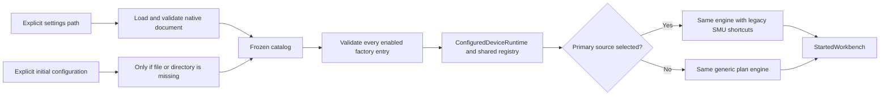

# Configured workbench startup

DeviceConfigurationStartup is an Application composition use case. It resolves
one native device document and constructs a matching ConfiguredDeviceRuntime and
MeasurementRunService from injected Core document/factory ports. No driver is
connected and no device lease is acquired during construction.



```csharp
var startup = new DeviceConfigurationStartup(deviceDocument, deviceFactory,
    leases, notifications);
var started = await startup.StartAsync(devicePath, initialConfiguration: null,
    token: token, listeners: resultListeners);
await started.Runs.StartPlanAsync(plan, token);
```

A caller may provide an explicit initial configuration for a missing file or
missing directory. The returned origin states whether the runtime came from a
saved document or that initial configuration. This does not save a file or create
its directory. A malformed, inaccessible or unsupported existing document never
falls back to the initial configuration. Passing no initial configuration requires
the saved file to exist. Disabled entries remain authored configuration but are
not constructed. Native saved selection wins over initial selection.

The whole enabled factory set validates before any port is created. Cancellation
before load or after document loading prevents construction. Listener input is
materialized once, then the same execution lifecycle owns delivery/finalization.
A selected source supplies only the legacy IV/resistance shortcuts; a null primary
constructs the generic executor with no placeholder source. This introduces no
new engine or infrastructure dependency.

Settings saves do not replace a live runtime. A fresh startup sees the saved
changes. Instrument parameter snapshots now retain display_name for sources,
axes and matrices, alongside existing instrument identity/model and configuration.
Names captured in a completed run stay unchanged after a settings edit and survive
fresh archive reading. This adds metadata rather than replacing hardware identity.

## Evidence and limitations

Fourteen startup cases cover explicit missing-file/missing-directory seed with no
save/connect/lease, absent seed, malformed/duplicate/inaccessible files, whole-set
unsupported-hardware rejection before construction, pre/post-load cancellation,
saved-primary precedence and next-startup changes, saved axes-only native six-row
execution/archive, one-shot listener input plus listener failure, and archived
source/axis/matrix names after settings edits.

The local desktop draft now calls this use case and uses the registry for its
instrument list. It supports null-primary plan controls, offline configuration
validation/load/save with restart messaging, device connect/refresh/disconnect,
and shutdown that waits for execution finalization before disconnecting manual
connections. Eight new ViewModel cases verify these behaviors. These App/App.Tests
changes remain uncommitted until native inspection at 1060x720 is possible; a
locked Mac prevents that acceptance. The published desktop still uses its prior
composition. Backend/startup test evidence is not native UI acceptance.

Physical transports, database/environment precedence, friendly typed device/routing
editors, hot restart/reconnect orchestration, full PPMS command and hardware
acceptance remain migration work. Only supported simulations execute today; there
is no automatic simulation replacement for configured hardware. The whole goal
remains active.
