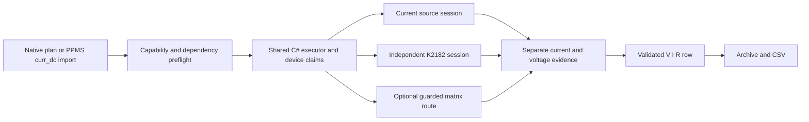

# Independent current DC resistance

This slice measures external voltage while a separately reserved source supplies
current, then computes R = V/I. Execution uses the existing independent C# engine;
OpenTAP is an architectural reference, not a package dependency. Current sources
now use either the K2450 boundary or the [pure K6221 DC boundary](k6221-current-source.md);
external K2182 voltage and K6221 DC output have explicit simulators. Real K6221
hardware support and electrical coupling of the simulators are not claimed.

## Acquisition contract

`ReadCurrentResistanceStep` has distinct source/meter IDs and V/I/R column IDs,
an Ampere threshold and optional expected programmed current. The expected value
is either a constant or a persisted active scan axis. Output enable, settings,
settling and route application remain explicit ordinary plan steps. Preflight
checks current preparation, passive-meter capabilities and guarded matrix bounds
before connecting or claiming devices.

- `ProgrammedSetpoint` uses a freshly confirmed current setting. It is **not a
  measured current** and carries no source-buffer quality. PPMS `curr_dc` uses
  this mode, matching its runtime calculation.
- `MeasuredSourceReadback` acquires a K2450 source-readback frame first, then
  triggers external voltage. Source buffer status/profile belongs to that source
  frame. Its internal voltage sense is not the external voltage measurement.

The source is queried before and after external acquisition; output, source,
sense and terminal drift discards the result. The meter independently confirms
settings across its read. Required matrix routes are freshly confirmed before
and after acquisition and must guard the excitation source. Separate capture
times and source confirmation interval persist; these are sequential observations,
not synchronized triggers. Timestamp ordering cannot establish physical stability
or eliminate transient changes between queries.

Current must exceed the declared absolute threshold and R must be finite. A valid
negative current retains its sign. Each row stores `IndependentResistanceEvidence`
and two input quality records; derived R has no invented buffer status. A measured
source warning remains visible even though external-meter hardware quality is
unobserved and the overall quality state is `PartiallyObserved`. Source protection
rejects before external read.

## Ownership and persistence

Source, meter, matrix and all guarded sources share atomic admission and existing
non-expiring run claims. Acquisition invalidates previous stop evidence. Pause
turns excitation off and confirms passive acquisition idle; resume checks actual
meter/source settings before output restoration. Abort/fault cleanup uses an
independent bounded token. Any missing source-off or meter-idle proof retains
the whole group until explicit safety recovery.

Live rows, archive writers and fresh streaming readers validate identities,
V/I/R arithmetic, reference kind, threshold, route, expected constant/axis and
input timestamps against the frozen plan. Wide points retain member evidence;
they do not manufacture a simultaneous frame. Optional archive-v1 evidence keeps
older archives readable by this implementation. Older strict consumers need an
update to understand the added field and plan kind. CSV adds
`independent_resistance_json` when the plan uses this acquisition. Rejected
exports preserve an existing destination file.

## PPMS import and fixtures

Supported subset: `meas_r` / existing resistance aliases, mode `curr_dc` (default),
current/compliance/source-range/meter-range/NPLC/input/settle aliases, owned and
scan-managed sources, plus the existing environment policy. Input 1 and 2 are
explicit integers. K2182 nominal ranges resolve upward. Current-resistance import
preserves actual filter settings rather than silently adding filtering.

The default names `k6221` and `k2182` are explicit binding aliases. A `k6221` alias
may point to the supported K2450 **only when deliberately supplied**; no driver
fallback or automatic hardware substitution occurs. Routed import requires an
`ImportChannelRoute` naming both source and independent voltage meter. Existing
source-meter-only wiring catalogs cannot supply that missing relationship.

Within an owning current scan, child current is overridden by the current scan
axis, as Rust does. Child compliance/source range/settle are retained as unused
metadata. Managed reads neither power-cycle nor reconfigure the source; an
explicit managed constant that disagrees with the actual source faults before
meter acquisition. Meter input/range/NPLC writes remain owned by the run.

- `examples/devices/current-resistance-devices.json`: explicit K2450 + K2182
  simulations; alias `k6221` deliberately maps to this K2450 simulator.
- `examples/plans/current-resistance.plan.json`: native direct V/I acquisition.
- `examples/plans/ppms-current-resistance-import.json`: signed current scan with
  a managed resistance child. Supply the native plan's current preparation to
  `ConfiguredDeviceRuntime.CreateImportBindings` when importing this fixture.

The read-only Rust reference is commit
`35763295f63b612f70af9dc55983644f437c18ea`, `channel_resistance/curr_dc.rs`,
`mode.rs`, `shared.rs` and `handlers/scan_children.rs`. No Rust edits, new
dependencies, lab IO or UI changes are included.

## Remaining work

PPMS terminal voltage acquisition single retry is now supported; see
[current-resistance-retry.md](current-resistance-retry.md). Explicit native and PPMS current DC recovery into invalid points is now
verified; see [current-resistance-invalid-points.md](current-resistance-invalid-points.md).
Ineligible errors, drift/cancellation/cleanup failures and native policies without
continuation still terminate the run. Real K6221/K2182 transports,
delta/pulse/AC, synchronized acquisition, physical safety/timing acceptance and
native settings/editor/history/plot acceptance remain required. This is a tested
subset, not full PPMS parity.

Pure K6221 DC simulation now runs this acquisition with a model-specific native
preparation and archived model identity. Its programmed current cannot claim a
measured source readback. See [k6221-current-source.md](k6221-current-source.md).

Automatic channel routing from frozen catalogs now supports explicitly bound
current sources and independent voltage meters. Owned acquisition and managed
scans retain native/wide/archive/CSV evidence. Independent current-DC sample analysis is now supported. See [independent-channel-routing.md](independent-channel-routing.md).

Independent current-DC sample acquisition and Hall/van der Pauw analysis now share
the existing sample pipeline, preserve both source/meter roles and retain every
input record through wide points, native documents, archives and CSV. See
[independent-sample-resistance.md](independent-sample-resistance.md) for verified scope and remaining work.
