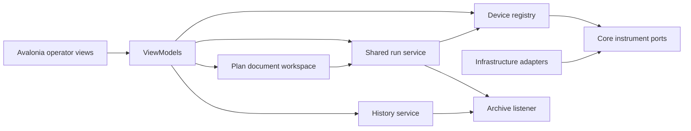

# Desktop operator integration

The previously local operator drafts are now part of the desktop implementation.
The composition root loads explicit device configuration, builds one registry and
run service, and shares the archive with history. Views bind to ViewModels;
ViewModels use Application workspaces/services, never concrete drivers.

## Behavior

- Measurement, plans, instruments/settings, current data, history and events are
  separate named views. The first-run device document is explicitly simulated;
  an invalid saved configuration reports failure instead of silently replacing
  it. Startup errors no longer incorrectly say all physical drivers are absent.
- JSON plans load, validate and save through `ExperimentPlanWorkspace`. Edits
  invalidate run admission. Plan/file/manual-device commands lock while the
  shared backend owns a run. Pause/resume/abort and safety recovery use that same
  backend; close awaits finalization and disconnect policy confirmation.
- The outline now descends into timeout, retry, fallback, subtree, while,
  result/callback, outcome/threshold branches and measurement group members.
  Current step facts target authored IDs; unrelated run IDs are ignored.
  This is a structured outline plus JSON editor, not the planned graph editor.
- Plan rows show the latest200 committed rows; historical rows and export retain
  typed units and metadata. History currently loads a full catalog/run before
  presenting200 rows. The separately implemented paged/plot ViewModel still needs
  wiring into this surface; acquisition memory and graph editing remain work.

## macOS accessibility correction

Native acceptance reproduced an unhandled `ElementNotEnabledException` when a
late accessibility call invoked an already disabled Button. The existing
[Avalonia11.3.8 peer](https://github.com/AvaloniaUI/Avalonia/blob/11.3.8/src/Avalonia.Controls/Automation/Peers/ButtonAutomationPeer.cs)
checks enabled state and throws; its
[native callback](https://github.com/AvaloniaUI/Avalonia/blob/11.3.8/src/Avalonia.Native/AvnAutomationPeer.cs)
does not contain that exception.

`OperatorButton` keeps the Button style/keyboard/command behavior. Only on macOS,
its invoke provider ignores calls while effectively disabled. Enabled command
errors are not caught. Non-macOS uses the original peer. ViewModel control entry
points also recheck current backend admission; a finalization race on pause is
reported without crashing the window. No library upgrade or blanket exception
handler was introduced.

## Verification and remaining acceptance

15 new App cases cover provider enabled/disabled/ancestor/command transitions,
visible enabled-command failure, late control invocation and ten nested outline
families. The18 earlier operator-draft cases remain; the App suite has80 cases.
Existing tests include failed stop retaining resources, failed close exposing
recovery, configuration validation and archive/CSV reopen behavior.

Native local self-contained packages opened at1060x720. Pre-repair rendering,
measurement start/pause/locked commands/resume/abort and a15-row joint scan were
observed. The disabled-button crash was reproduced with stderr and a macOS crash
report. The repaired peer survived native disabled calls before/after a21-row
completed run. The final source package exposed both timeout and its child,
reported an actual timeout, retained one row and confirmed simulated output-off;
its archive is Faulted with one row. A previous repair package closed normally.

The desktop then locked. Final-source native history/export, active-window close,
post-repair screenshot layout and clean committed-package parity remain
unverified. Earlier native evidence and unit tests do not replace these checks.
Physical hardware acceptance, graph editing, paged history integration and full
PPMS parity remain incomplete. Original29 drafts were backed up byte-for-byte
before acceptance repairs; they are being integrated, not silently discarded.
