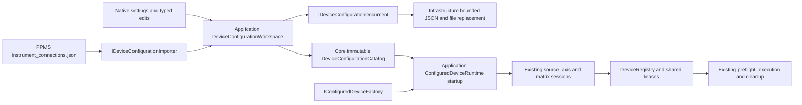

# Device settings and startup runtime

The device document is authored configuration, separate from live device status
and the experiment plan. Version 1 `instrument-workbench-devices` JSON retains
instance IDs, model/name/category, enable state, optional primary source, import
aliases, typed simulation/TCP/VISA/serial connections and optional matrix cards
with excitation guards. Simulation is an explicit transport and produces
`DriverKind.Simulation`; every physical transport is `DriverKind.Hardware`.



## Configuration ownership

`DeviceConfigurationWorkspace` performs load/save/import and typed upsert/delete,
primary selection and alias edits. The whole immutable catalog is validated on
every edit. IDs are unique, a selected primary must be an enabled source meter, aliases must
resolve, reserved temperature/field/angle aliases match controller categories,
and matrix guards must name excitation sources. An enabled matrix cannot depend
on a disabled source. Deleting referenced devices requires explicit edits first.
Collections are copied and read-only. No configuration operation contacts a driver.

Enabled physical instances cannot declare the same TCP host/port, VISA resource
or serial port within one catalog. This is a declaration check, not DNS resolution
or detection of the same device behind different transports/aliases. It provides
no protection across independent application processes.

## Startup construction and experiment binding

`ConfiguredDeviceRuntime` is startup construction, not a hot-reload operation.
It validates every enabled entry through the injected Core factory before creating
any ports, then wraps each in existing Application sessions and a shared registry.
A null primary supports axes-only startup/manual/resource management without
creating an unused SMU. The current MeasurementRunService constructor still needs
a selected source meter; general axes-only plan execution remains migration work.
It checks returned instance/name/driver kind, execution category, axis units and
matrix cards/guard references. Construction claims no lease and performs no IO.
The factory contract prohibits constructor IO; connection is owned by sessions.

The default Infrastructure factory currently builds the existing simulated K2450,
K3706, temperature, magnetic-field and rotation profiles. It supports distinct IDs
and names for multiple instances, with independent state. Unsupported enabled
models or physical transports reject explicitly; there is no automatic mock
fallback. Disabled hardware templates remain in the saved document and are
excluded from the runtime/import bindings. Matrix profiles require explicit cards
and guard IDs; the PPMS connection file does not supply these.

```csharp
var settings = new DeviceConfigurationWorkspace(
    new JsonDeviceConfigurationDocument(), new PpmsDeviceConfigurationImporter());
var saved = await settings.LoadAsync(devicePath, token);
var runtime = new ConfiguredDeviceRuntime(saved.Catalog,
    new ConfiguredDeviceFactory(), leases, notifications);
var runs = new MeasurementRunService(runtime.PrimarySource, leases,
    notifications, resultListeners, deviceRegistry: runtime.Registry);
var deviceBindings = runtime.CreateImportBindings(preparations);
// Bind the authored routing catalog explicitly, then import/preflight the plan.
```

Saving new settings never changes an existing runtime. A new startup gets fresh
ports and sessions; existing runs retain their captured devices/plan. The API is
available for composition and headless callers; the published desktop composition
has not yet been replaced by this startup path. Do not overlap physical runtimes
as a way to apply edits. Physical reconnect/resume, global endpoint ownership and
operator restart orchestration remain migration work.

## PPMS and file contracts

`PpmsDeviceConfigurationImporter` retains all eight current keys (k2450, k3706,
k6221, k2182, k6485, k6514, sr830 and rotator), TCP host/port/terminator/timeout,
VISA resource and serial port/timeout. SCPI devices accept TCP/VISA; rotator accepts
serial. Primary selection or absence is explicit. It reads only the supplied file: no DB,
environment overrides, builtin addresses/defaults or fallback are consulted.
Disabled state, multiple instances, matrix capabilities and environment controller
profiles are native extensions rather than invented contents of the PPMS file.

Both formats reject duplicate/unknown fields and bound UTF-8 to 1 MiB, JSON depth
to 16 and values to 50000. Native lists contain one to 64 entries; aliases contain
zero to 64. Timeouts must be positive and fit the .NET timer limit; decimal seconds
round-trip exactly at 100 ns tick precision. Sub-tick values reject instead of
silently changing timeout semantics. File reads honor cancellation, strict UTF-8,
BOM and growth limits. Save validates first, flushes a unique sibling temporary
file and replaces the destination; original and cleanup errors are retained.
Last writer wins. No CAS/multi-editor merge, transaction across device/routing
files or power-loss durability guarantee is claimed. No new dependency was added.

## Evidence and remaining work

`examples/devices/workbench-devices.json` is an independently authored simulation
setup with two SMUs, three axes, a matrix and one disabled hardware template.
`ppms-connections.json` is a synthetic eight-device input with loopback addresses.
Tests cover independent instances/no startup IO, explicit edits and reference
failures, unsupported-set rejection before construction, misleading factories,
all hardware transport round trips, malformed saves preserving old bytes, strict
file boundaries and parse budgets. Fresh file-loaded runtimes import the existing
28-row field/sample experiment, save settings while paused, preserve the original
source identity in its archive, and apply a different primary source in the next
runtime. Excitation output-off, route cleanup and reusable leases use the existing
safety lifecycle. Local actual-file import evidence is recorded in AI_MEMORY.md.

Physical TCP/VISA/serial adapters, database/environment precedence, device-specific
parameter settings, discovery/plugins, native operator panels/restart UX and
hardware acceptance remain required. This stage is configuration/startup foundation,
not physical driver or full PPMS configuration parity.
