# Environment observations attached to acquisitions

Current Rust `measurement.rs` reads temperature, magnetic field and angle for
every measurement through `context/publish.rs::read_measurement_environment`.
It retains fresh-read values, completion timestamps and failures. The schema's
legacy `record_temperature/field/angle` flags generate explicit auxiliary
measurement nodes in the frontend; they do not gate this current runtime capture.
Reference commit: `35763295f63b612f70af9dc55983644f437c18ea`, read without edits.

PPMS runtime import now attaches all three roles to each supported measurement,
including explicit environmental measurement nodes. Supplied controller bindings
become native readback addresses. An absent binding becomes an explicit unbound
observation; the importer does not guess a device instance. Boolean legacy flags
are accepted and validated. Existing native plans without context reads retain
their previous behavior and encoding.

```mermaid
flowchart LR
    A[PPMS measurement and frozen axis bindings] --> B[Typed environment-read policy]
    B --> C[Whole-plan capability and ownership preflight]
    C --> D[Electrical acquisition]
    D --> E[Fresh owned controller reads]
    E --> F[Values or unavailable observations with times]
    F --> G[Raw rows / sample analysis / wide scan points]
    G --> H[Validated archive and streamed CSV]
```

`EnvironmentRead` declares a role, distinct result column and optional source
address. Native `ReadStep`, `ReadSourceSenseStep` and `ReadResistanceStep` accept
up to three roles. Context cannot overwrite primary result columns or elapsed
time. Reusing primary columns requires one consistent context policy. Preflight
requires registered controller readbacks with Kelvin/Tesla/Degree units and
includes bound controllers in atomic resource admission. Reading a controller
target as environment data rejects before connection.

The existing resource service serializes operations. C# reads environment after
the electrical frame, in role order, using the run cancellation token. This
differs from Rust's concurrent futures and does not imply physical simultaneous
sampling. Each `EnvironmentObservation` preserves its source, typed value or
error, and the software UTC completion time. Paired electrical rows retain their
electrical frame timestamp; plain sequential read rows retain completion time.
There is no cached/target fallback, NaN, or fabricated zero.

Read, timeout, unit and range errors become unavailable observations. Successful
electrical data survives, subsequent roles and measurements still execute, and
failed optional quantity columns remain absent. Cancellation still aborts the
capture. A cancellation during context capture does not commit that incomplete
row. Independent cleanup must confirm every touched device; a failed controller
hold retains safety-recovery ownership even when the environment error itself
was recorded as data. Context readings are optional observations, not interlock
or stability decisions. Explicit `ReadStep`/`WaitStableStep` failures retain their
ordinary fatal behavior.

Hall/vdP preserves observations on every electrode row, including changes and
errors between readings. Its analysis row copies the first raw observation and
time without rereading the controllers. Wide points preserve every member's
final-result observations and their times; their member input ranges still refer
to the original raw/analysis rows. Requested scan axes remain separate quantities.

`RunDataRowValidator` checks declared policy, role/source, optional schema units,
quantity/evidence equality and required observations. Sample analysis and wide
points must retain the referenced observations exactly, including capture time
and errors. Archive writer and streaming reader share this validator. Optional
`environment` records and `environment_json` CSV retain diagnostic evidence;
CSV failure preserves the old destination. Empty context fields omit from old
version-1 encodings; older readers may reject new fields.

The [field-point file](../examples/plans/ppms-environment-point-import.json)
executes two fields with two consecutive resistance measurements: four raw rows
plus two wide points. Tests verify distinct measured temperatures, all roles,
unbound/read/unit/range errors, output-off and failed-hold recovery, abort during
read, no-IO preflight, native save/load, fresh archive/re-execution, CSV diagnostics
and forged source/value/time/error/absence rejection. Existing six-row, twelve-row
and mixed-sample/profile examples verify the same context through their plans.

Hardware transport/atomic timing, quality/range/filter profiles, corrected Hall,
remaining acquisition families, durable settings and native visual acceptance
remain migration work. Fresh software reads do not certify physical sensors,
firmware states, hardware protection or clock synchronization.
