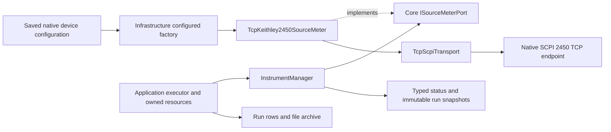

# K2450 native SCPI over raw TCP

This is the first physical-transport adapter behind the existing C# execution
ports. Its evidence is local TCP protocol acceptance, not real-instrument
certification. No laboratory endpoint was contacted and no new dependency was
added. The implementation uses the .NET SDK socket APIs.

## Supported contract

Only model `K2450`, category `SourceMeter`, transport `tcp` is registered in the
default factory. LF and CRLF terminators, including their literal escaped PPMS
representations, are supported. Other terminators reject before construction.
VISA, serial, other physical device models and binary/streaming SCPI remain
unsupported; enabled unsupported entries reject the entire startup set. They
never become simulations.

Constructors and startup open no socket and acquire no lease. Explicit connect
checks a bounded four-field Keithley 2450 identity and `*LANG?` native `SCPI`.
SCPI2400 and TSP reject. It never resets the device or changes its language.
Connect/status reconcile output, active source function/level/compliance, sense
function/two- or four-wire/NPLC/autorange and front/rear terminals. Disconnected
hardware status contains no observed parameter values and cannot confirm safety.
Capturing parameters while hardware is disconnected rejects rather than saving
initial or cached values as a new observation.
The low-level snapshot retains initial/last-known fields only; these are not
fresh observations.

Voltage and current source configuration reuse Core's coupled K2450 limits.
Changing source function requires observed output off. When changing a coupled
level/limit pair, the adapter chooses an order that keeps the intermediate pair
valid, then checks the error queue and actual readback. Exact requested/read-back
equality is required: instrument rounding or a rejected setting fails explicitly.
There is no tolerance policy or silent clamping. Source autorange is the default;
typed manual source ranges now reconcile and validate through the same ports and
run lifecycle. Range changes require output off, and scans preserve fixed ranges.
See [source-ranges.md](source-ranges.md).
sense autorange is configurable. Disabling sense autorange preserves the device's
existing manual range because the current Core sense profile has no explicit range
field. Autozero, filters, buffer/trigger recipes and compliance-quality flags are
not modeled in this stage.

Acquisition requires already enabled output under Application ownership. It
sets/confirms ASCII data and a single measurement count. Paired acquisition
enables/confirms actual source readback for the active source function and queries
`SOUR, READ` together in `defbuffer1`. The returned source value is measured,
not copied from the requested level. Function, unit and timestamp remain typed;
Application's existing post-acquisition reconciliation detects configuration
changes. Malformed, nonfinite, overrange or device-error responses produce no
data row. Single sense acquisition also checks the device error response.

## Communication and safety

The transport serializes each request/reply, bounds commands to 4096 printable
ASCII bytes and replies to 65536 bytes before LF, and supports fragmented LF/CRLF
responses. Unexpected queued bytes, surplus replies, control/non-ASCII data,
empty frames and premature EOF reject. Each exchange has a connection-configured
deadline. Failure or cancellation after dispatch closes the session; the next
operation cannot adopt a late reply or implicitly reconnect. Canceling a queued
waiter does not close another owner's active exchange. Disposal cancels/drains
an active exchange before closing its socket.

Driver operations hold a separate gate across dependent exchanges. This is
in-process serialization. SCPI provides no response IDs, and the software cannot
exclude front-panel or other-process changes or certify an electrical interlock.
The endpoint must follow the one-response-per-query contract; unsolicited streams
are unsupported.

Safe stop aborts acquisition, commands output off and requires a fresh output
readback. Disconnect requires observed output off. A closed socket is not proof
of disabled output. If cleanup cannot confirm safety, the existing executor
retains all group claims and non-expiring leases; other resources still receive
their independent stop attempts. Explicit `RecoverSafetyAsync(reconnect: true)`
can reconnect a quarantined source and freshly confirm output off before release.
It does not resume acquisition or substitute old observations.

## Usage and evidence

[The TCP template](../examples/devices/k2450-tcp-template.json) uses loopback and
is disabled with no primary selection. Author the actual endpoint, enable the
entry, and select a primary only when legacy source shortcuts are needed. Generic
plans bind the instance ID directly. Loading or saving configuration never
connects hardware. Native desktop settings/operator integration remains a local
draft awaiting its separate visual acceptance.

`TcpScpiTransportTests` and `TcpKeithley2450Tests` use owned loopback peers with
independent mutable registers, output state and error responses. They cover
concurrent request identity, fragmentation/budgets/EOF, cancellation/disposal,
native-mode/identity rejection, both source functions, valid intermediate
quadrants, rejected readbacks and error replies, pause/resume/abort,
output-off refusal/quarantine and explicit reconnect recovery. Fresh saved
configuration and plan files execute through both primary-selected and generic
startup paths, then reopen actual values/hardware identity from the archive.
No private addresses or vendor manual contents are redistributed.

Command behavior was checked against the manufacturer's
[2450 reference manual, revision E](https://www.tek.com/en/keithley-source-measure-units/keithley-smu-2400-series-sourcemeter-manual/model-2450-interactive-sou).
Actual firmware/transport timing, accuracy, compliance and physical wiring still
require separate hardware acceptance. `hardwareVerified` remains false.
