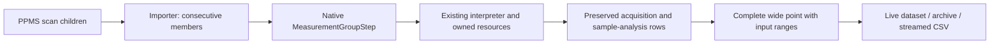

# Scan-point measurement groups

The PPMS importer now collects consecutive measurement children of a step scan
into `MeasurementGroupStep`. A non-measurement child flushes the pending group.
Scan-local `parallel` wrappers are traversed in authored order, including nested
wrappers; their measurement children join the pending group and other children
flush it. This supports Rust's scan aggregation convention, not simultaneous
driver IO or general behavior-tree parallel execution. Parallel parameters and
parallel nodes outside this scan context remain unsupported.

Each member contains exactly one logical acquisition, with its ordinary setup,
route verification, settling and cleanup. Hall and vdP are single logical members
whose input ranges include their raw electrode rows and final analysis row.
Member bodies cannot contain loops, branches or nested measurement groups.
Two to 64 members are allowed, with at most 1024 input rows. Result column IDs
must be distinct across members; duplicate display labels receive `#2`, `#3`,
etc., avoiding already occupied labels. One measurement keeps its existing row
layout and receives no additional point summary.

The wide point copies values from each member's final result row. Shared scan
columns must agree. Point timestamp and `elapsed` come from the first raw input;
every acquisition retains its own actual timestamp, elapsed time, readings and
sample/electrode routing in the original rows. Sample analysis identity, issue
flags and algorithm version remain on the referenced analysis rows. The point
does not pretend to be a single electrode reading or a new Hall/vdP analysis.
Indices are one-based within the entire native dataset, including earlier
summary rows.

For the field/sample fixture, each field produces one four-wire reading, three
Hall rows and nine vdP rows, followed by one wide point: 28 rows in total across
two fields, comprising 26 original records plus two points. The first point
references ranges `1+1`, `2+3`, `5+9`; the second starts at row 15.

The collector uses the ordinary run cancellation and pause checkpoints. It
publishes a point only after every member succeeds. Abort or read failure retains
already committed raw rows and any earlier complete points. Cleanup failure
retains the established safety-recovery ownership; grouping does not bypass
leases, output-off confirmation or matrix cleanup.

`RunDataRowValidator` is shared by live append, archive writing and streamed
reading. It retains at most 1024 recent rows and verifies the declared step,
labels, contiguous immediately preceding ranges, member acquisition columns,
validated sample analysis, values and first-input time. Forged unfinished-archive
points reject even without a terminal checksum; CSV replacement remains atomic.
Live datasets and in-memory history still retain all rows.

Native version-1 documents encode `kind: measurement_group` with labeled member
bodies. Archive rows optionally encode `measurementGroup`; plans containing groups
add `measurement_group_json` to CSV. Absent metadata is omitted, preserving the
old archive encoding. Older readers may reject the new step/field. Native rows
and CSV are not byte-for-byte Rust nested-result compatibility. General parallel execution, visual point filtering
and real-device acceptance remain migration work.

Evidence: `MeasurementGroupModelTests`, `MeasurementGroupExecutionTests`, the
field/sample runtime-file test and profile-file archive/re-execution test.
Reference: Rust `scan_children.rs` / `scan_aggregate.rs` at
`35763295f63b612f70af9dc55983644f437c18ea`, read without modifying that repository.
