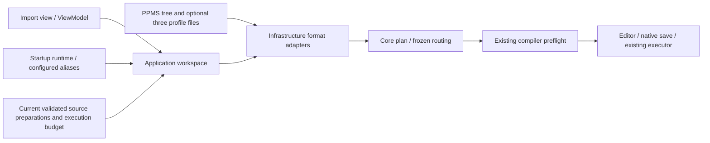

# Desktop PPMS plan import

The plan workspace now exposes PPMS runtime-tree import, optional channel/sample/
instrument-port profile loading, explicit matrix/wiring/source/meter selection,
cancel and restoration of the prior validated plan. Startup composition supplies
the existing import adapters and the same ConfiguredDeviceRuntime used by the
execution service. No View or ViewModel constructs drivers or talks to ports.

Aliases come from the enabled startup configuration and are displayed; they are
not inferred from model names or changed by unsaved device-settings edits.
Changing them still requires saving device settings and restarting. Source and
pure-current-source preparations are taken from the current validated plan, with
units/compliance and execution budget displayed. Import retains that budget and
preflights the candidate before replacing the plan. Editing a native preparation
currently uses the plan JSON; a full preparation form remains pending.

When routing is enabled, the operator loads all three authored profile files,
selects a registered matrix, explicitly includes each applicable wiring and
chooses its source plus optional standalone voltage meter. The channel wiring
must be one of those included. No first/active source or physical substitution
is guessed. Core Bind keeps the catalog's authored active channel/sample keys and
existing role/port/mode checks. Application rejects mismatched registry identity,
unknown devices and wrong matrix/source/meter categories even before import.
The captured request defensively freezes wiring selections. Whole-plan compiler
validation remains authoritative for capabilities, source functions, guarded
routes, variables, preparation constraints and budgets.

Source paths, bindings, budget, prior draft and option version are captured before
busy callbacks. Import/profile reads share the plan document busy admission,
blocking run, file/node edits and manual device operations. Cancel requests linked
cancellation but keeps admission until the actual read task finishes. Closing
drains both generated commands before disposing their lifetime. Post-read token
checks reject late results from noncooperative adapters. Changed paths/bindings/
drafts discard results rather than redirecting or overwriting the new state.

Profile path changes invalidate the loaded catalog. Reload failure/cancellation
may retain the old rows for inspection but disables profile-backed import until
a new successful load; the screen states this explicitly. Import failure and
cancellation retain the current plan. Success retains one recoverable pre-import
snapshot, including its dirty flag; Restore explicitly replaces the current
draft and revalidates it. Import never saves automatically or redirects the native
output path. The original PPMS files are read only by import; a later explicit
Save uses the separately chosen native plan path.

Actual PPMS field/voltage input exposed a label-generation defect: an empty meter
channel was sent to ResolveChannel while constructing group labels. Empty/
whitespace channel now falls back to the node name. MeterRouting already inherits
and verifies the enclosing source scan route. Explicit none/different-route
requests still fail; no energized switching or active-channel guessing was added.
Read-only Rust inspection at35763295f63b612f70af9dc55983644f437c18ea confirmed
scan_children.rs inherits nonempty parent channel and managed routing context.
C# intentionally retains its existing rejection of explicit bypass attempts.

14 new App and14 Application cases cover the actual file/profile import, native
save and six-row execution/output-off, unchanged source bytes, restore, malformed/
unsupported/unmapped input, budget retention, registry identity and role mistakes,
pure K6221/K2182 two-row acquisition, inherited-channel group labels and bypass
rejection, captured requests, stale catalogs, cancellation and actual task drain
on close. All138 App and focused14 Application cases pass. Publication records
contain the full audit and exact committed-source/package evidence.

Native acceptance remains pending: the Mac is locked. Earlier failed diagnostics
(PID69858 and88403) remain UEs with no observed terminal exit. No additional app
is launched solely because observation expired; the committed package can be
built without asserting a successful window. Dropdown/layout/import/cancel/
restore/run/close interaction and committed-package parity still require native
inspection after desktop access returns. No physical lab IO or Rust edits, no
new dependency. Independent C# engine/GitHub only/full goal remains active.
