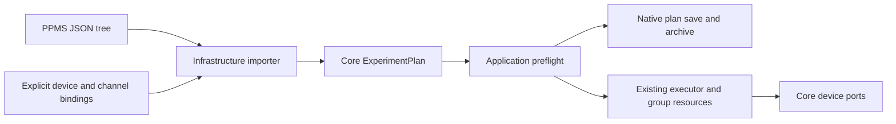

# PPMS JSON tree import

`PpmsExperimentPlanImporter` implements the Core `IExperimentPlanImporter`
format boundary with the existing System.Text.Json dependency. It translates
PPMS runtime trees into ordinary `ExperimentPlan` objects. The Application
`ExperimentPlanWorkspace.Import` / `ImportAsync` methods immediately preflight
and serialize the result in the native version-1 format. Import and preview do
not connect devices, claim leases or enable outputs. Execution remains in the
existing run engine; there is no second PPMS interpreter or direct importer IO
path to instruments.

## Input and explicit bindings

This accepts the runtime tree sent by the Rust/TypeScript PPMS application:
`type`, `name`, `params`, `children`, optional `experiment_id`, labels/IDs and
`source_line`. It does not parse the PPMS text DSL or a database export envelope.
Node types and known command aliases are trimmed and case-insensitive; parameter
keys are exact. An omitted node type follows the Rust `measurement` default.
Native step IDs are deterministic tree paths, independent of duplicate display
labels. Positive source-line numbers survive as typed plan metadata, including
through native saves, archives and CSV plan metadata.

`ExperimentImportBindings` freezes instrument-name-to-instance mappings, the
field/temperature/angle controller definitions, explicit source preparations and
optional channel routes. No global active channel, instrument discovery or
profile lookup is guessed. Unmapped K6221/K2182 identifiers are rejected;
substituting another device requires an explicit caller binding. Registered
capabilities are checked again by workspace preflight and run admission.

A named `ImportChannelRoute` supplies the source instance and exact existing
`RouteMatrixStep` crosspoints/settle. The compiler admits the matrix and every
excitation guard atomically. Routing and cleanup use the existing source-off,
break-before-make, readback and baseline-preserving policies. `channel: "none"`
explicitly selects external wiring. Empty/unknown source channels cannot silently
skip routing. Raw standalone meter reads support empty/none channels; their
routed acquisition and source/meter combinations remain migration work.

## Implemented translations

| PPMS input | Native behavior |
| --- | --- |
| sequence | Ordered sequence, including empty sequences |
| repeat / loop / repeat_n | Exactly one child, positive cycles; Rust default 3 |
| delay / wait_before | Delay before optional children; Rust default 1 second |
| wait / sleep with wait_kind=wait | Interruptible duration; default 5 seconds |
| set_field, set_angle and aliases | Typed target/rate writes, numeric stability and settle |
| set_temperature and aliases | Software ramp by default; explicit hardware ramp or direct setting, numeric stability and settle |
| set_voltage / voltage_set, set_current / current_set | Matching prepared source function, optional explicit route, parked zero, compliance/level and output enable |
| k2450.set_output / set_output_enabled | Owned output state change |
| k2450.set_source_level, set_compliance, set_nplc | Typed configuration writes with explicit function checks |
| scan_temperature / scan_temp | Software-ramped step scan; numeric stability, settle, then children |
| scan_field / field, scan_angle / angle | Step scans; stability and settle occur before children |
| scan_voltage, scan_current | Prepared source step scans, routing, first level before output enable, settle before children |
| read_temp/field/angle and aliases | Typed controller readback rows |
| measure_voltage/current, basic name=voltage/current and aliases | Explicit integrated meter binding/mode, NPLC write, independent read row |
| resistance / measure_r and aliases, mode=volt_dc | Owned channel or source-scan-managed coherent V/I/R, verified routing and output settling |
| meas_r_sample / 2w / 4w / hallbar / vdp and aliases, mode=volt_dc | Frozen sample/wiring resolution, role-specific raw V/I/R, complete Hall/vdP analysis groups |

The importer retains individual measurement rows with active nested axes and adds
a complete wide point for consecutive scan measurements. Scan-local parallel
wrappers join this collection in authored order. See
[measurement-groups.md](measurement-groups.md) for input identity and boundaries.
Standalone meter reads remain sequential; coherent native IV/source-sense reads
are a separate implemented step. Filtering is rejected. Matching meter_range_v/a
fields accept auto or finite positive numeric/string selectors for complementary
manual sensing; fixed selections require the corresponding prepared function.
See [sense-ranges.md](sense-ranges.md) for source/compliance guards and limits. Source
auto/manual ranges now map to typed owned writes with nominal/profile preflight
and K2450 TCP readback acceptance. See [source-ranges.md](source-ranges.md);
actual hardware acceptance remains pending.

Point specifications may be numeric arrays or objects with linear, signed-step,
log, inv_t or inv_t2 modes; flat start/end/count/step input is also supported.
The Rust one-point and floating-point spacing formulas are retained. Segments
without settle/repeat/mirror modifiers use the Rust stitching rule: every segment
after the first drops its first point, even when it differs from the preceding
endpoint. This deliberately does not call native `ScanValues.Segmented`, whose
boundary deduplication has different semantics. PPMS voltage set/scan requests
retain the original -200..200 V bound in addition to native capability checks.

## Temperature settings and step scans

The default software strategy follows the current Rust PPMS controller: live
origin, integer millikelvin targets, a fixed one-second tick, rounded rate/60
steps with a one-millikelvin minimum, and a clamped final target without a final
sleep. A positive rate must be 0.01..20 K/min. An absent/nonpositive set-command
rate performs a direct, unrounded target write with hardware ramp off. Explicit
hardware strategy with a positive rate programs the hardware ramp; `auto` uses
software for a positive rate and disables hardware ramp for a direct set.
`wait_mode=none` still awaits software target programming before subsequent
commands. It skips the separate numeric stability wait, not the ramp itself.

A temperature step scan defaults to 5 K/min. It translates to a native
`ForEachStep` followed by software ramp, stability, settle and children for each
point. It does not use an immediate target-writing `ScanStep`, which would jump
to the final temperature before ramping. The requested axis, its one-based index
and total are recorded independently of any explicit measured-temperature row.
The separate [temperature-control contract](temperature-control.md) describes
live-origin failures, mode confirmation, pause/resume, cleanup and limitations.

## Explicit incomplete work

Continuous/ramp/cooling modes, disabled temperature-control settings,
persistent magnet transitions, quench operations, state-based environment wait
commands, conditional/general parallel/retry/race/for_each BT semantics, remaining resistance modes/persistent profile editing, filtering, remaining ohmmeter/other-family sense ranges, changed source
functions, segment settle/mirror/repeat modifiers and additional instrument
families remain required. They produce an import error, not a no-op or silent
fallback. Numeric stability on bound controller ports does
not certify PPMS firmware holding/stable states or a physical interlock.

Documents are bounded to 4 MiB UTF-8, depth 128, 10,000 raw nodes and an aggregate
1,000,000 generated point budget; generated native wrappers and serialized size
are checked too. Workspace preflight additionally enforces the existing execution
budget. Unknown fields, invalid values, duplicate JSON properties, unsupported
nodes and unmapped settings fail before hardware IO. Diagnostics identify the
tree path and a valid source line when supplied. Load is bounded even if a file
grows and accepts a UTF-8 BOM. Cancellation before load is honored; CPU parsing
is synchronous and bounded. Import never rewrites the PPMS source file.

The runnable [PPMS field/voltage tree](../examples/plans/ppms-field-voltage-import.json)
is a runtime-tree fixture with real schema keys, basic measurement selectors and
source lines. Tests provide explicit matrix/source/controller bindings, execute
six routed nested rows, confirm output-off/held-axis/relay cleanup, save/load the
native plan, reopen a fresh archive, re-execute it and export CSV. Additional
cases cover aliases, both source functions, configuration commands, repeat/delay,
spacing, unsupported routes/ranges/modes, budgets, preflight, cancellation and
paused abort. This is simulated API acceptance, not full PPMS or hardware parity.

The [temperature/field/voltage tree](../examples/plans/ppms-temperature-field-voltage-import.json)
extends this acceptance to three temperatures, two fields and two routed voltages
(12 rows, four owned devices), native disk save/load, a fresh archive, re-execution
and CSV export. Firmware status, thermal plant behavior and real transport
acceptance are still separate work.

## Resistance and sample import

The [resistance import contract](ppms-resistance-import.md) adds current Rust
measurement registry/schema aliases, finite numeric/string parameters, coherent
actual V/I/R and explicit frozen sample-mode-wiring bindings. `volt_dc` uses the
existing integrated source meter. Other resistance modes keep their original
identity and reject until their actual source/meter execution paths exist.

The [field/sample runtime file](../examples/plans/ppms-field-samples-import.json)
executes 28 rows (26 acquisition/analysis records plus two scan points) across
two fields and three sample topologies, preserving raw
routes, complete-group analysis, native save/load, fresh archive/re-execution
and CSV. These supplied four-terminal profiles are simulations; the bundled
PPMS physical K2450 wiring is two-wire and cannot establish four-terminal
acceptance. No proprietary recipes or hardware addresses are used.

## Profile-file bindings

Workspace can load the three current PPMS routing configuration files through
IRoutingProfileImporter. The frozen catalog binds explicit supported devices
and resolves channel/sample aliases without hard-coded route reconstruction.
See [PPMS profile import](ppms-profile-import.md) for metadata, validation and
the independent-source/meter and hardware boundaries.

## Fresh acquisition environment

All supported imported measurements now capture temperature, field and angle
from bound controller readbacks, or retain an explicit unavailable observation
for unbound/read-error cases. Primary electrical data, acquisition times, raw
sample contexts and wide-point member identity persist through native plans,
archives and CSV. Legacy boolean record_* flags remain accepted. See
[environment-acquisition.md](environment-acquisition.md) for timing, cancellation,
error-as-data and physical acceptance boundaries.

## Number/time iteration scans (2026-10-11)

PPMS `scan_number`, `scan_time` and `time_s` now use native iterators with
explicit delay-before-point timing, bounded values, nested axes/index/total,
pause/cancellation, independent stop and retained failed cleanup, native/archive/
CSV re-execution. Existing iterators default to immediate execution. See
[iteration-scans.md](iteration-scans.md) and the five-row repository example.
K6221 raw TCP/mode safety is still under investigation; no hardware adapter or
UI changes are included. The full migration goal remains active.

## Workflow result controls (2026-10-11)

Native typed condition/fallback/retry/result decorators and PPMS control-node
import now share ordinary executor/resources. Logical failure propagates through
parents; errors/cancellation/safety are not swallowed. Branch/attempt axes, strict
preflight/dataflow/budgets, grouped quality/native save/fresh archive/CSV and
re-execution verified. See [workflow-control.md](workflow-control.md) and the
five-row `ppms-fallback-retry-import.json` example. Full exception recovery,
script conditions, parallel/timeout/background/subtree/native UI/hardware remain
incomplete. The full migration goal remains active.
