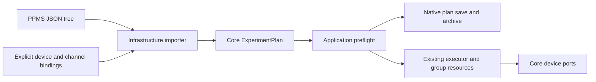

# PPMS JSON tree import

`PpmsExperimentPlanImporter` implements the Core `IExperimentPlanImporter`
format boundary with the existing System.Text.Json dependency. It translates
PPMS runtime trees into ordinary `ExperimentPlan` objects. The Application
`ExperimentPlanWorkspace.Import` / `ImportAsync` methods immediately preflight
and serialize the result in the native version-1 format. Import and preview do
not connect devices, claim leases or enable outputs. Execution remains in the
existing run engine; there is no second PPMS interpreter or direct importer IO
path to instruments.

## Input and explicit bindings

This accepts the runtime tree sent by the Rust/TypeScript PPMS application:
`type`, `name`, `params`, `children`, optional `experiment_id`, labels/IDs and
`source_line`. It does not parse the PPMS text DSL or a database export envelope.
Node types and known command aliases are trimmed and case-insensitive; parameter
keys are exact. An omitted node type follows the Rust `measurement` default.
Native step IDs are deterministic tree paths, independent of duplicate display
labels. Positive source-line numbers survive as typed plan metadata, including
through native saves, archives and CSV plan metadata.

`ExperimentImportBindings` freezes instrument-name-to-instance mappings, the
field/temperature/angle controller definitions, explicit source preparations and
optional channel routes. No global active channel, instrument discovery or
profile lookup is guessed. Unmapped K6221/K2182 identifiers are rejected;
substituting another device requires an explicit caller binding. Registered
capabilities are checked again by workspace preflight and run admission.

A named `ImportChannelRoute` supplies the source instance and exact existing
`RouteMatrixStep` crosspoints/settle. The compiler admits the matrix and every
excitation guard atomically. Routing and cleanup use the existing source-off,
break-before-make, readback and baseline-preserving policies. `channel: "none"`
explicitly selects external wiring. Empty/unknown source channels cannot silently
skip routing. Raw standalone meter reads support empty/none channels; their
routed acquisition and source/meter combinations remain migration work.

## Implemented translations

| PPMS input | Native behavior |
| --- | --- |
| sequence | Ordered sequence, including empty sequences |
| repeat / loop / repeat_n | Exactly one child, positive cycles; Rust default 3 |
| delay / wait_before | Delay before optional children; Rust default 1 second |
| wait / sleep with wait_kind=wait | Interruptible duration; default 5 seconds |
| set_field, set_angle and aliases | Typed target/rate writes, numeric stability and settle |
| set_temperature and aliases with ramp_strategy=hardware | Bound controller rate/target, numeric stability and settle |
| set_voltage / voltage_set, set_current / current_set | Matching prepared source function, optional explicit route, parked zero, compliance/level and output enable |
| k2450.set_output / set_output_enabled | Owned output state change |
| k2450.set_source_level, set_compliance, set_nplc | Typed configuration writes with explicit function checks |
| scan_field / field, scan_angle / angle | Step scans; stability and settle occur before children |
| scan_voltage, scan_current | Prepared source step scans, routing, first level before output enable, settle before children |
| read_temp/field/angle and aliases | Typed controller readback rows |
| measure_voltage/current, basic name=voltage/current and aliases | Explicit integrated meter binding/mode, NPLC write, independent read row |

The importer retains individual measurement rows with active nested axes. It does
not implement Rust's consecutive-measurement aggregation into a single scan row.
Standalone meter reads remain sequential; coherent native IV/source-sense reads
are a separate implemented step. Filtering/manual ranges are rejected, and auto
range is only accepted with an explicitly auto-ranged sense preparation. Auto source-range selection is accepted as the current simulation profile
default; its physical source-range command IO and transport acceptance are not
claimed.

Point specifications may be numeric arrays or objects with linear, signed-step,
log, inv_t or inv_t2 modes; flat start/end/count/step input is also supported.
The Rust one-point and floating-point spacing formulas are retained. Segments
without settle/repeat/mirror modifiers use the Rust stitching rule: every segment
after the first drops its first point, even when it differs from the preceding
endpoint. This deliberately does not call native `ScanValues.Segmented`, whose
boundary deduplication has different semantics. PPMS voltage set/scan requests
retain the original -200..200 V bound in addition to native capability checks.

## Explicit incomplete work

Software temperature ramps and temperature scans, continuous/ramp/cooling modes,
persistent magnet transitions, quench operations, state-based environment wait
commands, conditional/parallel/retry/race/for_each BT semantics, measurement
aggregation, resistance/sample import, filtering, manual ranges, changed source
functions, segment settle/mirror/repeat modifiers and additional instrument
families remain required. They produce an import error, not a no-op or silent
fallback. Hardware temperature setting must be explicit; an omitted/default
software strategy is rejected. Numeric stability on bound controller ports does
not certify PPMS firmware holding/stable states or a physical interlock.

Documents are bounded to 4 MiB UTF-8, depth 128, 10,000 raw nodes and an aggregate
1,000,000 generated point budget; generated native wrappers and serialized size
are checked too. Workspace preflight additionally enforces the existing execution
budget. Unknown fields, invalid values, duplicate JSON properties, unsupported
nodes and unmapped settings fail before hardware IO. Diagnostics identify the
tree path and a valid source line when supplied. Load is bounded even if a file
grows and accepts a UTF-8 BOM. Cancellation before load is honored; CPU parsing
is synchronous and bounded. Import never rewrites the PPMS source file.

The runnable [PPMS field/voltage tree](../examples/plans/ppms-field-voltage-import.json)
is a runtime-tree fixture with real schema keys, basic measurement selectors and
source lines. Tests provide explicit matrix/source/controller bindings, execute
six routed nested rows, confirm output-off/held-axis/relay cleanup, save/load the
native plan, reopen a fresh archive, re-execute it and export CSV. Additional
cases cover aliases, both source functions, configuration commands, repeat/delay,
spacing, unsupported routes/ranges/modes, budgets, preflight, cancellation and
paused abort. This is simulated API acceptance, not full PPMS or hardware parity.
