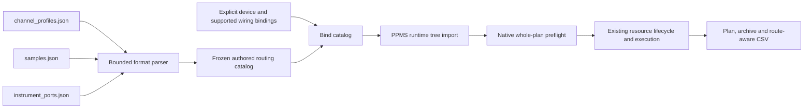

# PPMS routing profile import

The platform can load `channel_profiles.json`, `samples.json` and
`instrument_ports.json` through `IRoutingProfileImporter`. The concrete
`PpmsRoutingProfileImporter` adapts these formats; `ExperimentPlanWorkspace`
loads them through the Core port. Parsing and binding perform no instrument IO.



## Authored configuration and executable bindings

`RoutingProfileCatalog` retains all physical wiring layouts and mode mappings,
including separate source/meter families whose acquisition engines are unfinished.
`MatrixWiringLayout` has physical ports and a label; it does not invent a combined
source/meter device. `Bind` requires an explicit matrix ID, selected channel
wiring and wiring-to-integrated-source IDs already present in device bindings.
Only these selected supported bindings become native `InstrumentWiringProfile`s
and sample mode bindings. Unbound layouts remain available in the catalog and
are never represented as an implemented acquisition family.

The native run configuration contains the captured channel/sample catalog and
bound wiring. No global active file is consulted at execution time. Device-only
bindings are required when applying a catalog: competing explicit routes or
another catalog are rejected. Existing manually supplied `ImportChannelRoute`s
remain supported by the existing importer API.

Channel lookup accepts canonical profile key, authored `channel_id`, unique
display name or alias, numeric `channelN`, `chN`, and `__active__`. Lookup resolves
directly from the catalog rather than expanding aliases into duplicate bindings,
so all 64 allowed channels can be used. Sample lookup accepts canonical key,
authored `sample_id`, numeric slot and unique name. Colliding IDs/names/aliases
reject ambiguous queries, including an authored sample ID that conflicts with
another sample's numeric slot. Active sample identity is preserved in the catalog;
sample measurements still require an explicit sample identifier.

## Preserved fields

Native profile models and version-1 plan documents now preserve:

- Channel original ID, group index, alias and notes; connection index, label,
  enabled flag, optional slot/column, display row/raw address and notes.
- Sample original ID, name/topology, material, substrate, notes, electrode links,
  enabled flags and electrode notes; positive meter width/length/thickness/spacing.
- Wiring labels and physical force/sense slots and rows. Unbound physical layouts
  and the full mode map remain in the authored catalog.

Spacing is retained as authored metadata; the existing Hall algorithm still uses
width and length, and vdP resistivity uses thickness. Connection `row` and `raw`
are display fields, consistent with the PPMS resolver: executable rows come from
instrument wiring, executable columns from enabled channel connections. No raw
address fallback is used for a missing column. Disabled/unassigned connections
remain in the catalog but cannot satisfy a selected measurement role.

Optional native fields are omitted when empty, retaining old native document
encodings. Older readers may reject the new optional fields; this is not a claim
of backward reader compatibility. Saved plans and archives retain bound profile
metadata when reopened and re-executed, without rereading original PPMS files.

## Validation and limits

Each source document is limited to 4 MiB UTF-8, depth 32 and 10,000 JSON values.
Duplicate properties, unknown schema fields, malformed numeric/boolean values,
missing active keys, missing sample links and missing mode wiring reject. Each
catalog, connection/electrode list and mode map is bounded to 64 entries; profile
text is bounded to 8192 characters and names/identifiers retain native bounds.
Geometry must be finite positive meters. Async file reads are cancellation-aware,
bounded even if the file grows, accept a UTF-8 BOM and reject invalid UTF-8.

Channel role aliases use the captured Rust force/sense alias groups. All four
roles must resolve; slots must agree with wiring. Opposite polarities cannot
share ports or terminals. Four-wire sensing additionally requires four distinct
ports and terminals. Resistance `volt_dc` verifies that selected channel wiring
matches the file's mode mapping. Card/source/sensing capability and resource
preflight remain in the existing Application engine before any connection.

The three files are read sequentially and cross-references are validated; this
does not provide an atomic transaction over files edited concurrently.

## Usage and acceptance

Configure the workspace with `new PpmsRoutingProfileImporter()` as its optional
`IRoutingProfileImporter`. Then:

```csharp
var catalog = await workspace.LoadRoutingProfilesAsync(
    channelsPath, samplesPath, portsPath, token);
var bindings = catalog.Bind(deviceBindings, matrixId,
    [KeyValuePair.Create(new WiringProfileId("k2450"), sourceId)],
    new WiringProfileId("k2450"), routeSettle);
var document = await workspace.ImportAsync(runtimeTreePath, bindings, token);
await runs.StartPlanAsync(document.Plan, token);
```

The independently authored simulation fixtures in `examples/profiles` use the
current Rust schemas and include cross-channel Hall electrodes, disabled spare
contacts, descriptive metadata, shared two-wire wiring and an unbound separate
source/meter layout. Together with the existing field/sample runtime file, they
produce 26 rows and preserve metadata through native save/load, fresh archive
reopening, re-execution and CSV. Tests also exercise pre-connection rejection,
ambiguities, all channel aliases, 64-channel lookup, BOM/cancellation/UTF-8 and
format budgets.

A local read-only acceptance check at Rust commit
`35763295f63b612f70af9dc55983644f437c18ea` parsed the actual bundled files: six
channels, six samples, six wiring layouts and eight mode mappings. It resolved
`ch1` and round-tripped the converted native plan; it connected no hardware.
The bundled K2450 wiring shares force/sense rows. Import preserves that wiring
and cannot certify four-terminal sample operation. The fixture's independent
four-row wiring is simulation evidence only.

Persistent settings editing, writing profiles back to PPMS files/database,
separate-source/meter acquisition, additional runtime routing flags, instrument
transport/card protocols, native profile controls and hardware acceptance remain
required by the full migration goal.
