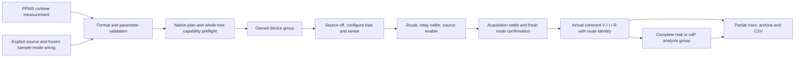

# PPMS resistance and sample measurement import

`PpmsExperimentPlanImporter` now translates the integrated `volt_dc` family
into the existing native engine. Routing, output lifecycle, cancellation,
measurements and analysis remain in Application/Core. This adds no package,
second interpreter or driver-owned experiment state.

## Supported inputs

The channel registry name is `resistance`; `measure_r`, `meas_resistance`,
`measure_resistance`, `res`, `meas_res`, `meas-res`, `rxx` and `rxx_rxy` resolve to
it. Sample inputs accept the unified `meas_r_sample` plus `measure_r_sample`
and `sample_r`, or the registered two-wire, four-wire, Hall and vdP primitives
and aliases from current Rust. A primitive must match the frozen sample topology.

`mode` / `meas_mode` must select `volt_dc`. The Rust default `curr_dc` is
retained, so omitting mode fails until the separate current-source/meter path
is implemented. Current DC, delta, pulse-delta and AC never silently become
an integrated SMU measurement.

Canonical numeric fields and captured Rust aliases are accepted for voltage,
compliance, NPLC, settle, source ownership, sensing mode and meter channel.
Finite invariant numeric strings are accepted; null optional numeric values use
their documented defaults. Duplicate aliases are explicit errors. Defaults are
0.1 V, 100 µA compliance, 1 PLC and 0.1 s post-enable acquisition settle.
Voltage remains inside ±200 V, compliance 1 nA..1.05 A, NPLC 0.01..10, and the
above-21-V compliance limit remains 105 mA. Native device bounds also apply.
The zero-current threshold is Rust `f64::EPSILON` (2.220446049250313e-16 A),
not .NET `double.Epsilon`. No zero/undefined resistance is invented.

Explicit role names must map to the same bound integrated K2450 source/meter.
Prepared source function must be voltage, sensing current.
Source-owned measurements accept auto or finite positive source range selectors,
including aliases/numeric strings; managed reads inherit the enclosing range.
See [source-ranges.md](source-ranges.md). Primary meter input remains required;
Current sense range selectors and their aliases now use owned typed writes,
with source-limit/power checks and actual TCP setting confirmation. Source-owned
measurements clear previous fixed spans while off; managed measurements retain
excitation. See [sense-ranges.md](sense-ranges.md). Filters, ohmmeter range
selection and additional device modes remain work.

## Frozen sample configuration

`ExperimentImportBindings.Samples` supplies `ImportSampleRouting`: a frozen
`RoutingConfiguration`, explicit mode-to-wiring map, optional sample aliases
and route-settle duration. Mapping targets must exist. Sample lookup accepts
canonical ID, a numeric `sampleN` slot, one unique display name or an explicit
alias; ambiguous names and aliases shadowing another canonical ID are rejected.
The configuration is stored in the resulting plan, so execution and archive
reopening never consult mutable global active profiles.

Electrodes, channels, wiring rows/slots, card limits, source guards and sensing
mode are checked before admission. A channel override cannot replace sample
links. The unified sample handler selects topology from that frozen profile;
Hall preserves two raw reads plus one analysis summary and vdP preserves eight
ordered raw reads plus one summary. Each raw row has exact sample/wiring/
electrode/crosspoint identity. Derived data uses the existing group analysis
and retains only complete groups across cancellation or faults.

Absent sample sensing mode is derived from configured topology and checked
against the preparation. This avoids silently using two-wire sensing for a
four-terminal profile; unknown wire-mode text rejects. Changing a single
source's two-/four-wire mode dynamically between imported samples is unfinished.
The present bundled Rust K2450 physical mode wiring shares source/sense rows and
supports two-wire samples. Supplied independent four-row profiles can exercise
the native four-wire/Hall/vdP simulation capability, but do not prove real
four-terminal wiring or certify hardware acceptance.

## Source ownership and settling

Owned channel reads turn output off, reconcile an explicitly bound route,
park source at zero, configure compliance/level/NPLC, enable, wait, verify the
accepted route, acquire coherent V/I/R and disable. An explicit `channel=none`
selects external wiring. Other missing/unknown routes cannot silently skip IO.

Owned sample import configures a group's bias and NPLC before its role-specific
readings. Each reading uses the engine's source-off/route/relay-settle/enable
path, then its separate `AcquisitionSettle` and fresh route verification before
sampling, followed by source disable. Existing native sample steps omit the new
settle key and retain zero post-enable wait. Pausing a dwell retains remaining
active time and group ownership; abort does not acquire an early row.

A channel read under an enclosing scan of the same source inherits scan-managed
ownership and the nearest applicable source channel. It leaves level/compliance
and output state alone, adjusts supported sense NPLC, verifies the accepted
route without changing relays, waits and reads. Explicit managed requests also
require source enable earlier in the admitted plan; run startup preparation
still controls the hardware. They cannot adopt a previous manual output. A
mismatched route fails rather than switching a live scan's measurement channel.
Sample handlers require their own source cleanup and reject an enclosing scan
of that same source, consistent with the Rust sample ownership rule.

`VerifyMatrixRouteStep` exposes read-only accepted-route confirmation as a
native version-1 document kind. It reserves the matrix/guards through normal
preflight and resources. Source/matrix snapshot observations are not physically
atomic and cannot replace a hardware interlock.

## Acceptance and remaining migration

The runnable [field/sample runtime tree](../examples/plans/ppms-field-samples-import.json)
uses real schema keys and source lines. It acquires two fields × (one four-wire
raw row + two Hall raw rows and summary + eight vdP raw rows and summary),
26 acquisition/analysis records plus two scan-point summaries, 28 rows in total
(see measurement-groups.md). Native disk save/load, fresh archive reopening, re-execution
and quoted routing/analysis CSV all preserve the result. Tests also cover
aliases, prepared sensing modes, managed voltage scans, managed-channel mismatch,
source-scan context lifetime, numeric parsing, invalid/coupled limits, pause,
abort, route drift during dwell, zero current, partial Hall read failure and
original-plus-stop-failure ownership/recovery.

PPMS file conversion now supplies these bindings (see ppms-profile-import.md).
Persistent profile editing and the remaining
resistance modes and source/meter roles, other-family/ohmmeter ranges and reading quality, dynamic preparation, settings/visual editor
and physical hardware remain required. Native row layouts and explicit analysis
summaries are not claimed as byte-for-byte Rust CSV compatibility. This is
simulated runtime import acceptance within the full migration goal.
