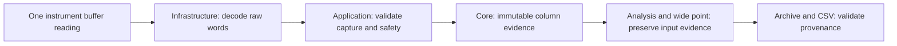

# K2450 acquisition quality evidence

The native TCP adapter requests values and both buffer status words in the same
ASCII `MEAS?` reply. Paired acquisition requests `SOUR, READ, SOURSTAT, STAT`;
single-channel acquisition requests `READ, SOURSTAT, STAT`. No later status query
is combined with an earlier reading. Replies must contain exactly four or three
fields respectively; status words must be finite integral unsigned 16-bit values.
Integral scientific notation is accepted. Malformed, nonfinite and overrange
numeric measurements are rejected.

The implementation uses independently authored protocol handling based on the
[official Model 2450 reference manual](https://www.tek.com/en/keithley-source-measure-units/keithley-smu-2400-series-sourcemeter-manual/model-2450-interactive-sou),
Rev. E sections 12 and 14. The manual is not redistributed with this repository.

`Keithley2450ReadingStatus` retains raw words and derives independent issues:
questionable sense measurement, source level limited, protection, overtemperature,
measurement limit results, unexpected origin and unknown bits. Start-group is
informational. Unknown bits are retained and flagged rather than discarded.

Application acquisition checks buffer output, wiring and terminal state against
the requested capture. Paired values also require the measured-source-readback
bit; a programmed source value cannot substitute for actual source measurement.
Protection, overtemperature or capture-state disagreement faults the run before
publishing a row. Normal cleanup still runs; failure to prove output off retains
claims and non-expiring leases until explicit safety recovery. Exception messages
include the raw words. Rejected frames are not published as successful rows.

Finite compliance-limited, questionable, test-limit and unknown-bit readings are
retained with issues. Resistance calculations use the measured source/sense pair,
but their quality is inherited from that pair. Sample analysis retains all raw
input column evidence; wide points retain each member result's input evidence.
Mathematical sample-analysis issues and acquisition-quality issues are separate;
a mathematically representable result does not clear an instrument warning.
Notifications report quality state, issues and observed-column counts.

Each `AcquisitionQuality` records the original step, device, column, host UTC read
completion time and optional raw status. Paired voltage/current/resistance
columns share one frame status/time. These counts refer to column evidence, not
independent readings. Wide points retain distinct sequential member timestamps;
they do not claim simultaneous capture. This stage does not record the device
clock timestamp or the actual autorange span used by a frame.

Rows distinguish `Unobserved`, `PartiallyObserved`, `ObservedNormal` and
`ObservedWithIssues`. Simulation, configuration reads, controller ports without
buffer evidence and old archives remain unobserved; a missing status never means
zero status. Partial observation retains known issues alongside unavailable
quality for other columns. UI consumers must use state and issues together.

The shared live/archive validator checks nonempty raw evidence against the
complete declared acquisition step, device/column bindings and capture times.
Analysis and wide-point summaries must preserve exactly the validated input
quality references. Mixing missing legacy member evidence with present evidence
in a new summary is rejected, avoiding a false complete-quality claim.

Archive v1 adds an optional `quality` array; absent legacy arrays remain readable
and unobserved. New plan-backed CSV exports append `quality_json`, including null
words for unobserved columns. No derived quality label is trusted from disk:
labels/issues are recomputed from raw words. Existing strict v1 readers and CSV
consumers may need updating. Validation is provenance consistency, not hardware
authentication; finalized archive checksums protect accidental alteration.

Tests use independent loopback peers and simulation. No physical K2450,
firmware compatibility sweep, real compliance accuracy, hardware timing or native
UI quality indicator acceptance is claimed. Other driver families, autorange
full-scale evidence, rebound/autozero/filter settings and UI presentation remain
follow-up work.
