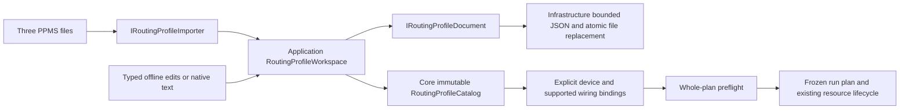

# Native routing profile workspace

Authored configuration can be imported from the three PPMS profile files, edited
offline and saved as one `instrument-workbench-routing` version 1 JSON document.
The native format retains active selections, channel connections and metadata,
sample electrodes/topology/geometry, physical wiring layouts and mode mappings.
`examples/profiles/workbench-routing.json` is generated from the independently
authored simulation fixtures and includes an unbound K6221/K2182 layout.



## Editing and execution boundaries

`RoutingProfileWorkspace` validates native text, imports, loads and saves documents.
Its typed operations upsert/delete channels, samples and wiring layouts, select the
active channel/sample, and assign/remove mode mappings. They return a new catalog
and canonical text. Each edit validates the entire catalog, including active keys,
electrode references and mode references. Deletes do not silently cascade; edit
references and active selections explicitly first. Profile order and descriptive
fields are retained. The workspace has no device registry, leases or driver calls.

```csharp
var profiles = new RoutingProfileWorkspace(
    new JsonRoutingProfileDocument(), new PpmsRoutingProfileImporter());
var document = await profiles.ImportAsync(channelsPath, samplesPath, portsPath, token);
await profiles.SaveAsync(nativePath, document.Text, token);
var restored = await profiles.LoadAsync(nativePath, token);
var bindings = restored.Catalog.Bind(deviceBindings, matrixId,
    [KeyValuePair.Create(new WiringProfileId("k2450"), sourceId)],
    new WiringProfileId("k2450"));
var plan = await plans.ImportAsync(runtimeTreePath, bindings, token);
await runs.StartPlanAsync(plan.Plan, token);
```

Saving a catalog does not certify sensing topology, card bounds or hardware.
Shared force/sense ports may be legitimate authored two-wire wiring; four-wire
preflight still rejects them before connection. Device-instance IDs are bound
explicitly after loading, rather than invented from physical layouts. Separate
source/meter layouts survive round trips without claiming an acquisition engine.
Execution reads its captured plan; editing/saving the profile while a run is
paused changes the next imported plan only. It never reroutes an active run.

## File contract and limits

The adapter uses SDK JSON/file IO and introduces no dependency. Native channel
and sample encoding is shared with the existing plan codec. Parsing rejects
unknown/duplicate fields, unsupported format/version, invalid units/geometry and
broken catalog references. Budgets are 12 MiB UTF-8, depth 32 and 100000 JSON
values; channel, sample and wiring lists each have one to 64 entries, and mode
maps have zero to 64 entries. File loading accepts UTF-8
BOM, rejects invalid UTF-8, bounds file growth and honors cancellation.

Save validates/serializes before replacing the destination, writes and flushes a
unique sibling temporary file, checks cancellation before rename and attempts
cleanup on failure. Original save and cleanup errors are retained together.
Replacement is last writer wins: there is no revision/CAS, multi-editor merge or
transaction over the original three PPMS files. Flush/rename does not guarantee
power-loss durability. No database, PPMS write-back, device settings or native
profile UI is delivered by this stage.

## Acceptance

Tests cover full metadata round trips and the checked-in native file; explicit
CRUD and active/mode edits; dangling references; byte/depth/value budgets;
invalid saves preserving old bytes; UTF-8/BOM/cancellation/rename failure; and
saved shared wiring rejecting four-wire execution before connection. A real
workflow removes the original three files, reloads the native document, imports
and executes the 28-row field/sample experiment, saves an edit while paused,
retains the old sample names in that run, reopens its archive and executes the
captured plan in a fresh workbench. Outputs and run-added matrix routes finish
safe in simulation. Physical transport and visual acceptance remain pending.
