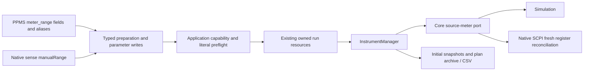

# K2450 fixed sense ranges

This stage adds typed fixed measurement spans to the existing Core, Application
and Infrastructure path. It introduces no dependency, port or second executor.
Source and sense range settings remain distinct.

## Typed configuration and supported selection

`SenseConfiguration.ManualRange` is an optional `Quantity`. A non-null value
requires `AutoRange=false`, a canonical nominal measurement span and the sense
function's unit. Current choices are 10 nA through 1 A in decade steps. Voltage
choices are 20 mV, 200 mV, 2 V, 20 V and 200 V. Core exposes immutable choices and
an explicit upward selector resolver. Native manual values are exact nominal
choices; PPMS accepts positive finite numbers/numeric strings or auto.

Explicit manual voltage/current selection requires complementary sourcing and
sensing: source voltage / sense current, or source current / sense voltage.
When source and sense functions match, hardware ties the measurement span to the
source range; this stage rejects an independent manual selection. Resistance
nominal spans can be reconciled and observed, but the resistance-range parameter
is read-only. Selecting an ohmmeter range/source strategy remains unimplemented.

A fixed span can cause hardware to adjust source compliance. Core requires
compliance above 0.1% and at most 105% of that span, alongside source bounds and
the source/sense nominal power envelope. In particular, a 200 V source range
cannot pair with a current sense range above 100 mA; a 1 A source range cannot
pair with a voltage sense range above 20 V, including at zero source level.
Automatically ranged sources also check the corresponding level boundaries.
These guards reject implicit limit adjustment rather than describing it as a
successful unchanged request. They do not certify physical protection.

| Parameter | Access | Behavior |
| --- | --- | --- |
| `k2450.manual_sense_voltage_range` | Read/write, V | Active fixed voltage span |
| `k2450.manual_sense_current_range` | Read/write, A | Active fixed current span |
| `k2450.manual_sense_resistance_range` | Read, ohm | Observed resistance span only |
| `k2450.sense_auto_range` | Read, dimensionless | Actual automatic-mode flag, 0 or 1 |
| `k2450.enable_sense_auto_range` | Write, dimensionless | Enable action; only 1 is accepted |

Inactive-function or automatically ranged manual spans are unavailable to reads.
Selecting a span validates actual current source settings before mutating IO.
Native SCPI permits a live sense-span change, so an owned run may change it
without cycling source output. Registry operator writes remain denied during
runs, including pause. A failed or unexpected setting enters the existing
fault/independent-stop/quarantine/recovery path.

## Native documents and PPMS import

The optional `sense.manualRange` quantity is encoded only when present. Existing
automatic documents retain their shape. `autoRange=false` without a span retains
the selected function's existing range: the TCP adapter queries its register,
validates it and confirms the actual fixed span. Such documents do not authorize
an invented default as hardware evidence. Simulation chooses an explicit
simulated nominal span. Old strict version-1 readers may reject populated fields.

Compiler preflight validates preparation capability, literal nominal choices,
active sense function and fixed-span source/compliance changes. Range-changing
plans and dynamic values receive actual per-write validation. Preflight does not
claim whole-program hardware-state inference.

PPMS `measure_current` and `measure_voltage` accept their matching
`meter_range_a/v` field. A manual standalone read requires the corresponding
frozen sense function. Inactive-function fields and filtering remain errors.
`volt_dc` channel and routed sample resistance accepts `meter_range_a` and
`sense_range_a` / `current_range_a` aliases; duplicate aliases still reject.
Source-owned resistance clears the old fixed sense mode while output is off,
updates excitation, then selects the requested sense span. Scan-managed
resistance preserves active excitation and applies its valid sense range under
the same owner. Defaults explicitly enable sense autorange.

Repreparing consecutive runs releases the old fixed sense restriction while
output is confirmed off, then applies the new source and sense configuration.
Legacy retain-mode preparations retain an observed matching-function span.
This supports switching between both source functions without stale-range
constraints blocking the new valid configuration.

## Actual settings, acquisition and archive

TCP snapshots query the actual manual span when autorange is off. Sense writes
confirm the requested settings and unchanged source configuration, output and
terminals; a device that adjusts compliance produces an error. Both single and
paired acquisitions compare post-read source/sense state. A changed manual span
invalidates the observation before insertion. Paused span drift prevents output
restoration. Existing overflow/error replies never become finite data rows.
Independent cleanup uses its own token; failed output-off retains claims and
nonexpiring leases until explicit safety recovery succeeds.

Run parameters are initial after-preparation snapshots. They now include
`sense_range_mode`, `sense_auto_range` and the actual active manual span. Native
plans, immutable archive reload and CSV retain the configuration. Later planned
writes are not per-row actual span evidence. Autorange's selected full scale,
full per-reading range/quality/status evidence, rebound/limits/autozero/filter
settings and measurement accuracy are still work.

## Verification

[The combined range scan](../examples/plans/source-sense-range-scan.plan.json)
loads with `workbench-devices.json`, executes three paired rows on `smu-primary`
and leaves unrelated devices disconnected. `SenseRangeModelTests` and
`SenseRangeExecutionTests` add 62 cases (27 Core, 35 Application), covering
nominal tables, unit/power/compliance boundaries, both source functions,
legacy documents/actual retained registers, native save/archive/CSV, configured
fixture, active parameter access, static/dynamic failures before writes,
refused/implicitly changed settings, live range changes and failed-stop recovery,
single/paired acquisition drift, pause drift, consecutive preparation, PPMS
owned/managed/standalone numeric-string selectors and line diagnostics, and
physical overflow replies. The existing routed sample range-alias test now
checks both source and sense range. Only deterministic simulations and owned
loopback peers were used; no lab endpoint was contacted.

Nominal tables, command behavior and source-limit interaction were checked
against the manufacturer's [2450 reference manual E](https://www.tek.com/en/keithley-source-measure-units/keithley-smu-2400-series-sourcemeter-manual/model-2450-interactive-sou),
source limits / measurement ranges and SCPI sense range sections. No vendor
manual is redistributed. `hardwareVerified` remains false. Ohmmeter range
selection, other instrument families, quality/status, native editors and real
hardware acceptance remain required; the full PPMS migration remains active.
