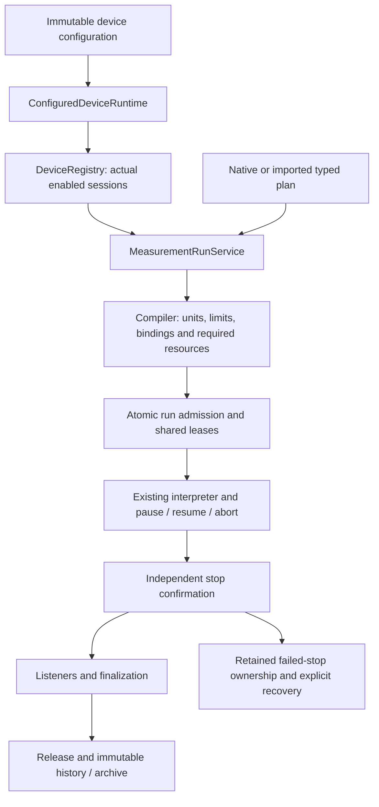

# Source-independent execution

Generic execution is constructed from the registered device capabilities. It does
not require a selected source meter. This removes the startup dependency on an
unused SMU for temperature, field and angle experiments and resource-free control
plans. It does not introduce another execution engine.



```csharp
var runtime = new ConfiguredDeviceRuntime(catalog,
    new ConfiguredDeviceFactory(), leases, notifications);
var runs = new MeasurementRunService(runtime.Registry, notifications, listeners);
await runs.StartPlanAsync(plan, token);
```

The compiler determines the required devices from the whole plan, including
preparations and environment bindings. Admission claims only those devices. A
selected source outside the plan is never connected, stopped or included in its
snapshots. Resource-free assignment/delay plans need no device claim. The same
run state, cancellation, result and finalization rules apply.

Legacy construction with InstrumentManager remains available for IV and voltage
resistance recipe shortcuts. Generic construction rejects these two shortcuts
before IO because there is no selected source. Explicitly bound source plans,
sample recipes and analyzed sample recipes use their own device references.

Run lifecycle facts carry the RunId. InstrumentId is the participating legacy
primary when applicable, otherwise the sole required device, otherwise null.
This avoids naming an unrelated SMU in a field-only run or inventing an owner for
multi-device/control-only runs. Device state facts and instrument snapshots retain
the actual device IDs.

## Acceptance evidence

The independently authored axes-only device document enables three simulated
controllers with null primarySource. The native axes-only scan produces six joint
rows. The imported PPMS axes-only scan produces 24 rows: six complete points, each
with three raw measurements and one collected wide row. Tests load/save the plans,
run them, reopen the archive through another adapter, export CSV outside the
source archive and replay its plan on a fresh runtime with no source meter.
Actual controller readbacks and environment observation IDs are retained; this is
not evidence that physical controllers reached every requested setpoint.

Twelve acceptance cases also check:

- Pause holds all participating axes; resume restores targets; abort releases
  confirmed resources and retains acquired rows.
- Read failure and hold failure retain both errors; healthy controllers stop
  independently. Failed confirmation retains all claims until explicit recovery.
- Finalization retains claims until every listener finishes; listener failure
  remains visible in the outcome even when acquired data is complete.
- Pre-canceled execution and invalid limits cause no connection; cancellation
  still publishes terminal lifecycle facts. Explicitly bound second-source
  execution never touches the first source.
- An unrelated live source with a foreign lease remains enabled and untouched
  during field-only execution. Control-only runs can pause/resume/abort and archive
  with zero instrument snapshots and zero data rows.

This stage adds no dependency or UI changes. Physical adapters, native operator
composition and visual acceptance, DB/environment precedence and remaining PPMS
command families are still migration work. Hold means the controller's existing
hold-position policy; it does not certify physical de-energization or thermal
safety. The overall migration goal remains active.
