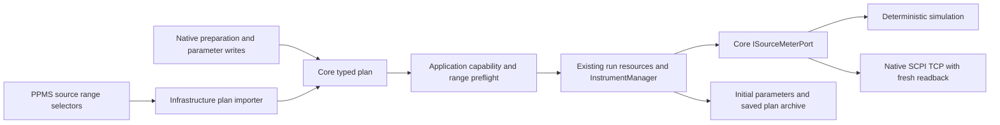

# K2450 source range settings

Source ranges now flow through the existing Core source model, Application
resource ownership and Infrastructure adapters. This stage adds no dependency
or separate execution engine. It covers source ranges; explicit complementary
sense ranges are implemented in [sense-ranges.md](sense-ranges.md), while reading
quality remains migration work.

## Domain and parameters

`SourceSetpoint.ManualRange` is an optional typed quantity. Null means automatic
source range. A manual value must be a nominal K2450 range in the active function's
unit. Voltage choices are 20 mV, 200 mV, 2 V, 20 V and 200 V; current choices are
10 nA through 1 A in decade steps. Core exposes immutable choices for editors,
drivers and import validation. Native settings require exact nominal choices.
Source levels allow 105% headroom within a selected range while retaining the
existing coupled source/compliance envelope. The 200 V range limits compliance
to 105 mA; the 1 A range limits voltage compliance to 21 V, including at zero
level. These declared profiles do not certify physical protection.

Both source adapters advertise:

| Parameter | Access | Contract |
| --- | --- | --- |
| `k2450.manual_voltage_range` | Read/write, V | Select/read the active manual voltage range |
| `k2450.manual_current_range` | Read/write, A | Select/read the active manual current range |
| `k2450.source_auto_range` | Read, dimensionless | Actual source autorange mode, 0 or 1 |
| `k2450.enable_source_auto_range` | Write, dimensionless | Explicit enable action; only value 1 is accepted |

Manual range reads are unavailable when autorange or the other source function
is active. Selecting a manual range or enabling autorange requires observed
output off. Existing manager/run ownership denies manual operations during a
run, including pause. Level/compliance writes preserve the selected range and
validate against the actual current configuration before adapter IO.

## Plans, import and execution

Native `SourcePreparation.ManualSourceRange` is optional. Version-1 documents
encode it as `manualSourceRange: {"value": 0.2, "unit": "Volt"}` only when manual;
existing automatic documents retain their shape. Older strict readers may reject
the new optional field. Unknown/non-nominal/wrong-unit choices reject. Compiler
preflight checks capability support, fixed-range static points and range-limited
compliance even when the other source field changes. Dynamic values and plans
that change the range itself receive actual per-write validation at runtime.

PPMS `set_voltage`, `set_current`, `scan_voltage`, `scan_current` and source-owned
`volt_dc` resistance imports accept `source_range_v/a` auto, finite numeric values
and numeric strings. Approximate positive selectors resolve upward to a nominal
full scale (for example 0.05 V selects 200 mV). Zero, negative, nonfinite and
out-of-profile selectors reject with source-path/line diagnostics before IO.
Imported scans check every point with the selected range/compliance. Resistance
source-range aliases retain the same validation. Source-managed resistance
inherits its enclosing source settings and does not change the source range.
Sense range selectors now follow [sense-ranges.md](sense-ranges.md); filtering
fields remain explicitly unsupported.

Source range changes compile into existing typed parameter writes while output
is off. No driver interprets PPMS JSON. TCP configuration freshly reads range
mode/manual full scale. When changing range, it enables autorange while setting
the new level/compliance, then selects/confirms the requested manual range. A
level update within an unchanged manual range leaves that range in place.
Rejected settings produce no output-enable or data set. An externally changed
range during acquisition invalidates the frame; a paused-range change prevents
output restoration. Existing stop/quarantine/reconnect/finalization applies.

Run instrument parameters are initial snapshots after preparation. They include
source range mode and the actual manual range when selected. Later parameter
changes remain in the archived plan. Per-row range observations require explicit
parameter reads; automatic selected full scale and complete per-frame quality
evidence are still pending. Planned later settings must not be treated as a
new physical observation.

## Evidence and remaining work

[The source-range scan](../examples/plans/source-range-scan.plan.json) binds
`smu-primary` in the native simulation device fixture and executes three paired
rows. `SourceRangeModelTests`, `SourceRangeExecutionTests` and the sample-import
case provide 45 new cases: all nominal ranges/headroom/units/power bounds,
canonical selection, existing auto format, saved plan/archive/CSV, native
fixture, both actual TCP source functions, static/dynamic bounds, owned parameter
access, rejected/live range changes, acquisition and pause drift, PPMS
numeric-string scans/automatic reset and routed four-wire sample acquisition.
Local TCP peers were used; no lab endpoint was contacted.

The declared nominal ranges and operating constraints follow the manufacturer's
[2450 reference manual E](https://www.tek.com/en/keithley-source-measure-units/keithley-smu-2400-series-sourcemeter-manual/model-2450-interactive-sou),
sections on source ranges and operating boundaries. Actual firmware/range
transitions, physical measurement accuracy, ohmmeter ranges/autozero/filter/quality,
other source families and native settings/editor acceptance remain required.
`hardwareVerified` remains false and the full PPMS goal remains active.
