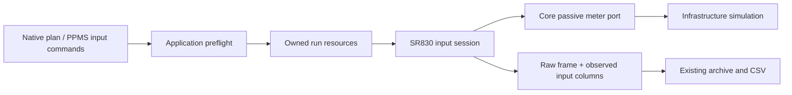

# SR830 passive input and raw frame acquisition

Differential PPMS scans use DC bias plus an SR830 AC lock-in path. The read-only
Rust scan_didv/scan_dvdi and channel_didv implementations confirm that dependency.
This prerequisite implements the SR830 input boundary, not a replacement based
on numerical differences of ordinary DC readings. Differential/AC excitation and
composite routing remain pending in the feature inventory.

## Boundaries



The device category is LockIn and stop policy is AbortAcquisition. The Core port
has no source-enable or reference-oscillator operation. Hardware SR830 settings
reject at factory validation; no serial/VISA/TCP fallback silently becomes a mock.
A configured SR830-only runtime needs no primary SMU. Generic native writes and
reads use the same session, operation gate, atomic leases and cancellation as
other devices. A frame read invalidates an earlier idle confirmation. Failed
stop retains ownership until explicit recovery confirms acquisition idle.

Input settings cover four registers: input mode A/A-B/I-1M/I-100M, the exact
27-value sensitivity register table on its voltage scale, the exact 20-value time
constant table, and filter slope 6/12/18/24 dB/oct. Units and discrete settings
reject before writes; the observed coupled input/sensitivity configuration also
rejects combinations that would automatically change the 100M gain. Setting
writes must confirm the requested input subset before acquisition continues.
Grounding, coupling, reserve, notch/sync filters and autogain remain outside this
subset. Sensitivity register values are not advertised as calibrated amperes.

## Raw frame and data

`read_sr830_frame` performs one port frame acquisition, checks the explicitly
selected input mode, and observes settings before/after. Changed settings,
acquiring/disconnected state, canceled reads and timestamps outside that interval
discard the entire frame before measured blackboard values or a row are published.

Eight output columns use the authored prefix: x_v, y_v, r_v, theta_deg, input_mode,
sensitivity_v, time_constant_s and filter_slope_db. The first four preserve raw
reported volts/degrees; the latter four record the observed input subset. They
share the existing native schema, blackboard, grouped measurements, row budgets,
bounded notifications and archive/CSV infrastructure. Frame prefixes cannot
collide with another full/scalar acquisition. Archive validators require all eight
columns and valid nominal settings matching the native step. Quality remains
unobserved; this profile reports no overload, reference-unlock or hardware status
certification. Current-input modes still expose raw voltage-domain data.

The [manufacturer manual](https://www.thinksrs.com/downloads/PDFs/Manuals/SR830m.pdf)
(remote programming input/filter and data-transfer sections) specifies the
register tables and SNAP pair timing. X/Y and R/theta have a small relative timing
offset, so the implementation preserves reported R/theta rather than recomputing
them from X/Y. Its oscillator amplitude floor is nonzero; acquisition idle must
not be described as oscillator output off. This passive profile cannot execute
`sr830.configure_ref` or `SourceOutputStep`. Future excitation support needs its
own verified mute/isolation and matrix guard lifecycle.

## PPMS commands and reproducible simulation

Imported commands: sr830.set_sensitivity (sensitivity_v/sensitivity),
sr830.set_time_constant (time_constant_s/time_constant), sr830.set_filter_slope
(filter_slope_db/filter_slope), sr830.set_input_config (input_config/config).
Choose one alias per parameter. The instrument alias must be explicitly bound;
unknown aliases, extra fields, ambiguous names and invalid nominal values reject.

```sh
dotnet run --project src/InstrumentControlWorkbench.Cli -- validate \
  --devices examples/devices/headless-sr830.devices.json \
  --plan examples/plans/headless-sr830-frame.plan.json

dotnet run --project src/InstrumentControlWorkbench.Cli -- run \
  --devices examples/devices/headless-sr830.devices.json \
  --plan examples/plans/headless-sr830-frame.plan.json \
  --archive /absolute/path/runs --csv /absolute/path/raw.csv
```

The native fixture configures four input registers and records three repeated
frames with an iteration axis. The mock reports fixed raw voltages, independent
of any DC source/sample; no device/sample transfer function is implied.
ppms-sr830-input-commands.json exercises the four PPMS command aliases, usable
with the same explicit device manifest and native context. No signal source is
enabled. Tests cover native save/fresh archive/blackboard/CSV, grouping, table and
unit validation, ignored settings, acquisition drift/timestamps/cancellation,
column collisions, pause drift, stale stop proof and retained failed cleanup.
Native forms and physical acceptance remain deferred; no desktop process/window
is launched and no new package dependency is added.

Read-only reference observations, normalized port units and nominal input-referred
analysis are now documented in [sr830-reference-analysis.md](sr830-reference-analysis.md).
The original eight-column default and passive stop policy remain valid.

## Active acquisition follow-up

An explicit, separate active simulation capability is now described in
[sr830-active-isolation.md](sr830-active-isolation.md). This passive stage
retains its original boundary; the active raw-frame stage does not establish
physical isolation or full curr_ac/differential-measurement parity.
