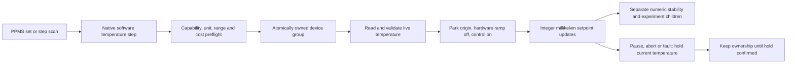

# Software temperature control

This migrates the current Rust PPMS software setpoint algorithm into the
independent C# executor. It is verified on controllable ports and simulation;
there is no physical temperature-controller adapter or hardware certification.

## Port and execution boundary

`AxisControllerDefinition.SupportsSoftwareTemperatureRamp` declares the
capability. It requires a bounded Kelvin profile inside 1..310 K and an actual
`ITemperatureControlPort`; registering a plain axis with that flag is rejected.
The port handles hardware-ramp/control configuration and protocol details.
Application sessions perform ownership, validation and readback confirmation;
the run engine owns stepping, pause and cancellation. No UI or importer accesses
the port directly.

Before changing control mode, execution reads a connected, valid live temperature
and validates it against the writable target range. The adapter prepares software
mode by parking at that supplied origin with hardware ramp disabled before
enabling control. Application checks that initial target and both flags. Read
failure stops this operation: it does not use a cached old setpoint or the
requested endpoint. This is deliberately stricter than Rust's fallback behavior.
Every subsequent software target write checks mode/control before writing and
checks connection, target readback and configuration afterward. These snapshots
are not atomic hardware interlocks; external changes between protocol operations
remain a physical integration concern.

Hardware temperature-rate writes explicitly set hardware-ramp-on/control-on,
then confirm the mode and rate. A successful generic rate setter cannot silently
leave software mode enabled. Other axis types retain their existing rate port.
Initial control flags are included in immutable run instrument metadata; they
are an initial snapshot, not an execution trace. The full saved plan records the
requested policy and nominal rate.

## Numeric and timing contract

With positive rate, start and goal round to integer millikelvin using
`MidpointRounding.AwayFromZero`, matching Rust `f64::round`. The step is
`max(1, round(rate_K_per_min / 60 * 1000))` millikelvin at each one-second tick.
Direction follows the live origin; the last step clamps to the rounded goal.
Generation is lazy, with no allocated list for a maximum 309,000-update path.
The first update occurs immediately and the last has no following sleep.
Each inter-update dwell excludes paused time and preserves its remaining
duration; resuming cannot cause a wall-clock catch-up burst. Driver IO adds
its own latency to this minimum cadence, as in the Rust loop.

A nominal 5 K/min becomes 83 mK per second (4.98 K/min). At 0.01 K/min the
one-millikelvin floor gives 0.06 K/min. This quantization is inherited behavior,
not a claim of exact continuous-rate tracking. Positive rates must be
0.01..20 K/min. A native null rate means a direct, **unrounded** set with
hardware ramp off and control on. If rounded start and goal match, C# explicitly
confirms the rounded goal once after the initial hold, instead of leaving an
unrounded initial hold as the final target.

Targets are checked against the controller's narrower range, including rounded
endpoints; dynamic expressions are checked before mode preparation. Preflight
conservatively bounds each ramp using the entire declared temperature range,
because live temperature is unavailable without IO. Repeated ramp paths count
toward the existing 10,000,000-execution budget. This can reject a large plan
whose actual small thermal excursions would be cheaper.

Completing a ramp means its final setpoint was programmed. It does not mean the
physical sample reached temperature. `WaitStableStep` separately measures the
readback against the requested goal, tolerance and active-time stability window.
PPMS `wait_mode=none` skips that wait while still awaiting setpoint programming.
A sub-millikelvin tolerance may fail against a rounded goal; tolerance is not
silently widened.

## Pause, cancellation and cleanup

Pause captures target and control flags, confirms current-temperature hold and
retains the entire device group. Resume verifies every temperature configuration
before any axis restoration or source output enable, then checks it again around
target restoration. Drift refuses resume and requires fresh hold cleanup rather
than reusing the old pause confirmation. Original failures remain visible.

Abort interrupts inter-update dwell and stops further programming; it never
jumps to the requested endpoint. Cleanup uses independent cancellation and
existing stop deadlines. Failed or timed-out holds retain all group ownership;
explicit recovery is required before reuse. Holding current temperature does
**not** turn off heater control or cool the sample to a base temperature.

The simulator models a lagging readback separately from target programming. Its
existing slew model continues to limit the simulated plant after hardware ramp
is disabled; this is simulation tracking, not a cryostat thermal-physics model.

## Acceptance and remaining work

Tests cover physical origin versus old target, both ramp directions, rounding,
minimum rate, final clamp, multi-update cadence, direct precision, configuration
and read/write faults, pause/resume timing, paused drift with a source kept off,
abort, ownership, failed hold recovery, preflight budgets, native documents,
archive reload/re-execution and CSV. The PPMS runtime fixture runs 12 nested
rows across temperature, field, voltage and matrix routing.

Continuous sampling/ramp/cooling modes, true background temperature handlers,
disabled-control commands, firmware-specific holding/stable status, heater/range
limits, real transport and hardware acceptance remain required. This stage is
part of the PPMS migration, not full behavioral or hardware parity.
