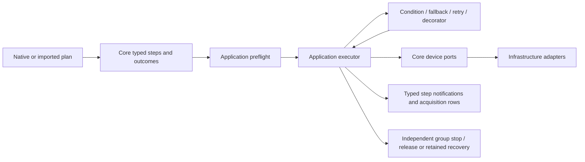

# Workflow results, fallback and retry

Core `StepOutcome` distinguishes ordinary workflow Success/Failure from errors.
`ConditionStep` evaluates a typed variable/constant or variable/variable comparison
with matching units. `FallbackStep` tries ordered branches until one succeeds.
`RetryStep` makes a bounded number of attempts with a pause-aware delay between
failed attempts. `ResultDecoratorStep` applies ForceSuccess, ForceFailure or
Invert to the child's result. These are native plan nodes, executed by the same
Application engine and shared device resource lifecycle as scans/acquisition.

## Result and error semantics

Sequence, repeat, scan, iterator and selected if/else branches propagate Failure
and stop subsequent children/points. Fallback returns Success at its first
successful branch; all-fail returns Failure. Retry returns Success at its first
successful attempt; exhaustion returns Failure. Terminal Failure becomes a
`PlanFailedException` identifying the originating condition/result decorator,
a Faulted run outcome and the normal independent cleanup. Each completed node
publishes its own typed outcome in `WorkbenchNotification.Outcome`.

**Exceptions are never transformed by workflow controls.** Transport, timeout,
unsupported configuration, validation, routing, listener and safety errors remain
errors. Cancellation and operator abort propagate without another branch or
attempt. ForceSuccess cannot turn a failed stop into completion or release.
Stop failures retain the whole group until explicit successful safety recovery,
including when workflow evaluation had already succeeded.

The Rust handlers in the read-only reference at35763295 catch broad errors in
fallback/retry/decorators (with different cancellation protections). C# deliberately
makes recoverability an explicit domain decision. This stage imports PPMS control
shapes for logical results; it does not promise broad Rust exception-swallowing
parity. Existing acquisition-specific retry/invalid-point policies keep their
own fresh state/cleanup proof. Generic recovery of driver exceptions, timeouts,
parallel cancellation and background/subtree/script-expression behavior remains
separate unfinished work.

## Scope and provenance

Fallback and retry add dimensionless 1-based `.branch`/`.attempt` and `.total`
columns derived from their step IDs. Child measurements depend on those active
axes; rows after the control omit the optional scope columns. Failed logical
branches/attempts retain committed observations, grouped summaries and quality.
Nothing fabricates a device, rolls back physical writes or discards valid rows.

Each branch/attempt starts from the variables at control entry, plus its scope
counters. A failed branch cannot inject variables into the next alternative;
physical settings stay under the existing exclusive lease and validated ports.
Only variables available on every successful path are admitted downstream.
Decorators cannot guarantee new variables after an early child failure. If/else
merging now also removes variables absent on a path, preserving the same rule.
Optional invalid acquisitions cannot resurrect a previous observation.

Preflight visits every branch, including branches skipped at runtime, before IO.
The worst execution budget sums fallback branches and multiplies retry attempts;
existing 10,000-node/128-depth/10,000,000-execution/document limits apply. Counts,
delays, null children, enums, condition units and unknown variable dependencies
reject before admission. Pause during backoff confirms output-off/hold, reserves
the group and resumes the remaining delay with verified settings/output state.

## Formats and acceptance

Native version1 adds `condition`, `fallback`, `retry`, `result_decorator` kinds.
Retry explicitly stores `maxAttempts`, `delaySeconds`, `body`; decorators store
`effect` and `body`. Named enums and strict fields prevent unknown controls from
silently downgrading. Native saves and reopened archives retain executable steps.
CSV retains acquisition, nested branch/attempt axes, grouped evidence and plan.

PPMS `fallback`, `retry`, `force_success`, `force_failure`, `inverter` types map
to these models. Retry defaults to3 attempts and0 delay_ms; delay_ms is a bounded
nonnegative integer. Decorators/retry require exactly one child rather than
silently ignoring extra children. Fallback requires a nonempty children array.
Malformed controls preserve tree-path/source-line diagnostics. PPMS condition
expression strings are not treated as this typed native ConditionStep.

[ppms-fallback-retry-import.json](../examples/plans/ppms-fallback-retry-import.json)
runs five simulated field observations across three alternatives: one forced
failure, two bounded failed attempts, one forced-success result, then a read
outside the control. It needs no source preparation and converts to a native
plan for fresh execution.

Focused acceptance:9 Core `ControlStepTests`,53 Application `ControlFlowTests*`.
Tests include both result directions, all parent propagation, variable isolation
and definite availability, bounded attempts, local raw-TCP acquisition rejection
through all five controls, cancellation, pause/backoff, committed listener fault,
failed hold/root-cause preservation/recovery, hidden invalid branch and execution
budgets, strict native/import codecs, actual PPMS fixture and native grouped
quality save/reopen/archive/CSV/re-execution. No new dependency, Rust write,
physical laboratory IO or App draft change. This is an active migration slice;
full PPMS, native editor/operator acceptance and hardware remain incomplete.
