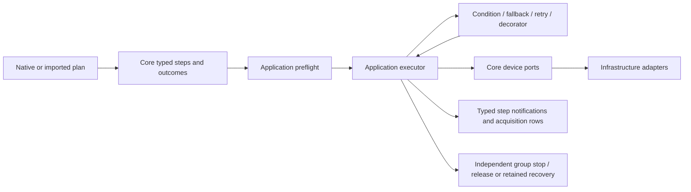

# Workflow results, fallback and retry

Core `StepOutcome` distinguishes ordinary workflow Success/Failure from errors.
`ConditionStep` evaluates a typed variable/constant or variable/variable comparison
with matching units. `FallbackStep` tries ordered branches until one succeeds.
`RetryStep` makes a bounded number of attempts with a pause-aware delay between
failed attempts. `ResultDecoratorStep` applies ForceSuccess, ForceFailure or
Invert to the child's result. These are native plan nodes, executed by the same
Application engine and shared device resource lifecycle as scans/acquisition.

## Result and error semantics

Sequence, repeat, scan, iterator and selected if/else branches propagate Failure
and stop subsequent children/points. Fallback returns Success at its first
successful branch; all-fail returns Failure. Retry returns Success at its first
successful attempt; exhaustion returns Failure. Terminal Failure becomes a
`PlanFailedException` identifying the originating condition/result decorator,
a Faulted run outcome and the normal independent cleanup. Each completed node
publishes its own typed outcome in `WorkbenchNotification.Outcome`.

**Exceptions are never transformed by workflow controls.** Transport, timeout,
unsupported configuration, validation, routing, listener and safety errors remain
errors. Cancellation and operator abort propagate without another branch or
attempt. ForceSuccess cannot turn a failed stop into completion or release.
Stop failures retain the whole group until explicit successful safety recovery,
including when workflow evaluation had already succeeded.

The Rust handlers in the read-only reference at35763295 catch broad errors in
fallback/retry/decorators (with different cancellation protections). C# deliberately
makes recoverability an explicit domain decision. This stage imports PPMS control
shapes for logical results; it does not promise broad Rust exception-swallowing
parity. Existing acquisition-specific retry/invalid-point policies keep their
own fresh state/cleanup proof. Generic recovery of driver exceptions and timed-out operations,
parallel cancellation and background/subtree/script-expression behavior remains
separate unfinished work.

## Scope and provenance

Fallback and retry add dimensionless 1-based `.branch`/`.attempt` and `.total`
columns derived from their step IDs. Child measurements depend on those active
axes; rows after the control omit the optional scope columns. Failed logical
branches/attempts retain committed observations, grouped summaries and quality.
Nothing fabricates a device, rolls back physical writes or discards valid rows.

Each branch/attempt starts from the variables at control entry, plus its scope
counters. A failed branch cannot inject variables into the next alternative;
physical settings stay under the existing exclusive lease and validated ports.
Only variables available on every successful path are admitted downstream.
Decorators cannot guarantee new variables after an early child failure. If/else
merging now also removes variables absent on a path, preserving the same rule.
Optional invalid acquisitions cannot resurrect a previous observation.

Preflight visits every branch, including branches skipped at runtime, before IO.
The worst execution budget sums fallback branches and multiplies retry attempts;
existing 10,000-node/128-depth/10,000,000-execution/document limits apply. Counts,
delays, null children, enums, condition units and unknown variable dependencies
reject before admission. Pause during backoff confirms output-off/hold, reserves
the group and resumes the remaining delay with verified settings/output state.

## Formats and acceptance

Native version1 adds `condition`, `fallback`, `retry`, `result_decorator` kinds.
Retry explicitly stores `maxAttempts`, `delaySeconds`, `body`; decorators store
`effect` and `body`. Named enums and strict fields prevent unknown controls from
silently downgrading. Native saves and reopened archives retain executable steps.
CSV retains acquisition, nested branch/attempt axes, grouped evidence and plan.

PPMS `fallback`, `retry`, `force_success`, `force_failure`, `inverter` types map
to these models. Retry defaults to3 attempts and0 delay_ms; delay_ms is a bounded
nonnegative integer. Decorators/retry require exactly one child rather than
silently ignoring extra children. Fallback requires a nonempty children array.
Malformed controls preserve tree-path/source-line diagnostics. PPMS condition
expression strings are not treated as this typed native ConditionStep.

[ppms-fallback-retry-import.json](../examples/plans/ppms-fallback-retry-import.json)
runs five simulated field observations across three alternatives: one forced
failure, two bounded failed attempts, one forced-success result, then a read
outside the control. It needs no source preparation and converts to a native
plan for fresh execution.

Focused acceptance:9 Core `ControlStepTests`,53 Application `ControlFlowTests*`.
Tests include both result directions, all parent propagation, variable isolation
and definite availability, bounded attempts, local raw-TCP acquisition rejection
through all five controls, cancellation, pause/backoff, committed listener fault,
failed hold/root-cause preservation/recovery, hidden invalid branch and execution
budgets, strict native/import codecs, actual PPMS fixture and native grouped
quality save/reopen/archive/CSV/re-execution. No new dependency, Rust write,
physical laboratory IO or App draft change. This is an active migration slice;
full PPMS, native editor/operator acceptance and hardware remain incomplete.

## Wall-clock timeout scopes

`TimeoutStep` owns one executable child and a typed TimeSpan deadline. Native v1
stores `kind: timeout`, `timeoutSeconds` and `body`. PPMS `timeout` and schema alias
`with_timeout` import `timeout_s` (default 60 s) and require exactly one child.
Nonfinite, negative, unknown, null and wrong-type fields reject before IO. Zero
means immediate expiration before child execution, not an unlimited wait. The
upper bound is the existing .NET timer range (4,294,967.294 seconds).

The reference Rust handler uses `tokio::time::timeout`; its deadline includes
operator pause. C# likewise counts wall-clock time, including child dwell and
paused waits. Scope entry creates a deadline linked to the parent token, and all
existing child locks, port calls, waits and ordinary listeners receive that token.
Nested scopes preserve their parent cancellation. Completion restores the parent
token and disposes the timer, so later steps cannot inherit an expired deadline.

Expiry is `PlanStepTimeoutException` with the timeout step ID, deadline and original
cancellation. It faults the run and prevents fallback/retry/forced-result controls
from hiding it. Explicit operator abort remains Aborted; genuine driver/listener
errors remain their original errors. A child's ordinary Failure still propagates
with its original workflow step identity. Timed-out nodes do not publish a success
completion notification. Acquisition rows already committed remain partial data.

The engine awaits the actual child until it settles; it never abandons a task or
releases claims while an instrument call remains live. Deadline expiry initiates
cancellation; prompt stop therefore requires the adapter to honor cancellation.
An adapter that ignores it retains the active run and its whole resource group
until the call returns. This is not a hard real-time deadline or forceful hardware
interrupt. After drain, the normal independent bounded stop runs; failed or live
stops retain the group for explicit recovery. Pause expiry cannot restore output.

Compilation and all data/document validators descend into timeout children. A
short or zero deadline cannot hide unsupported devices, invalid variables, depth,
node/value limits or the worst-case execution budget. Variables produced by a
completed scope can flow downstream; a forced-success wrapper around an early
logical failure cannot guarantee variables defined after that failure.

The executable [PPMS timeout fixture](../examples/plans/ppms-timeout-import.json)
collects three simulated field observations through nested deadlines. Acceptance
covers native save/load, fresh archive/CSV/re-execution, partial faulted archives,
vdP raw/derived sample evidence under a deadline, nested cancellation, pause,
operator abort, refused cleanup and noncooperative live-call retention. No new
package, physical IO, Rust edit or original UI draft change. Parallel/subtree/
background/script-expression controls, native flow editor and hardware acceptance
remain pending; full PPMS migration remains active.

## Subtree variable scopes

`SubtreeStep` contains authored children and explicit typed `VariableBinding`
inputs/outputs. A child inherits the current parent quantities. Inputs map parent
source IDs to child destination IDs, reading one complete parent snapshot; local
input aliases can shadow inherited units within the child. Child assignments and
acquisitions update local variables. Only declared outputs are copied back, using
one completed child snapshot. Output destinations must retain existing parent
units, or introduce a new typed parent variable.

A successful empty scope may export inherited values. A logical Failure, exception
or cancellation restores the parent variables and exports nothing. An outer
ForceSuccess may convert ordinary Failure, but cannot leak failed-scope writes or
make newly defined outputs guaranteed. Nested scopes restore the nearest parent.
All children, input dependencies, output availability/units and execution budgets
are validated before admission, including branches skipped at runtime. Missing
inputs/outputs and duplicate/ambiguous mappings reject instead of falling back to
stale values or mapping order. Both mappings freeze their caller-owned lists.

Variable isolation leaves acquisition rows, quality, analysis summaries and actual
instrument writes under the same run/resource group. It does not roll back device
state. Actual scan coordinates remain in row axes; an input alias does not relabel
those observations. Pause resumes the same local scope. Timeout/abort and driver
faults unwind scopes before the existing independent stop, retained claims and
explicit recovery. Local variable cleanup cannot authorize release after bad hold.

Native version1 stores `kind: subtree`, `children`, `inputs` and `outputs` (objects
mapping source ID to destination ID). PPMS `subtree`, `scope`, `isolated` use
optional `params.inputs`/`params.outputs` objects and a required children array.
Map values must be valid string IDs; duplicate destinations are invalid. Zero to
10,000 children and up to10,000 bindings per map are bounded by the existing
whole-document/plan budgets. The Rust reference copies inputs parent→child and
outputs child→parent through an inherited blackboard. C# implements that numeric
quantity scope; Rust Bool/Text blackboard values and expression controls
remain further migration work.

The [nested PPMS subtree fixture](../examples/plans/ppms-subtree-import.json) runs
four field observations inside two number-scan iterations. Acceptance adds native
checks consuming the exported final number/field and a fifth observation outside
the scan, then saves, reopens, exports CSV and re-executes on fresh sessions.
Additional tests preserve vdP raw/derived evidence and grouped-quality archives
under a subtree. Mapping swaps, inheritance, local unit shadow, output unit
collision, early failure through ForceSuccess, cancellation, timeout, pause,
actual device state and retained failed hold are exercised. No new package,
physical IO, Rust edits or original29 UI draft changes. Full PPMS migration,
non-numeric blackboard/expressions, parallel execution and native editor/hardware
acceptance remain incomplete.

## Branching on a child outcome

`BranchOnOutcomeStep` executes Condition once on the same run context, then
executes Then for Success or optional Else for ordinary Failure. Missing Else
returns Success after a false condition. The selected child's outcome becomes the
branch outcome; a selected Failure keeps its original step identity. Condition
observations and variable/device mutations remain; there is no entry snapshot or
physical rollback. Instrument IO, listener faults, timeout and cancellation
propagate through the branch without choosing Else.

Preflight visits all children before device admission and budgets the condition
plus the largest branch. Then can use values guaranteed after condition success.
Else conservatively retains entry variables for a condition which can fail early;
a completed IO-only child wrapped in ForceFailure/Invert retains its observed
values on the failure path. Values after the branch must have the same unit on
both paths. No speculative failed-path variable is treated as an observation.

Native v1 uses `branch_outcome` with required `condition`/`then` and optional
`else`; explicit null children and extra fields reject. PPMS `if_then_else`,
`conditional`, `branch` node mode takes exactly two or three children; `then` and
`else` are sequence wrappers. Source locations survive conversion. PPMS numeric mode (`variable`, `op`, `value`) is described below. Existing
typed `IfElseStep` remains the numeric API; this node-result slice does not
claim while or arbitrary expression parity.

Tests cover exact branch selection/outcomes, condition state, guaranteed-variable
preflight, hidden invalid branches and costs, IO/timeout/listener error
propagation, abort in condition and selected branches, pause, retained ownership
on failed stop and recovery. `ppms-outcome-branch-import.json` runs five rows,
saves/reloads native plans and archives, exports CSV and executes in a fresh
service; grouped quality and vdP raw/derived evidence also round-trip under the
branch. These are simulation and owned loopback protocol tests, not lab or UI
acceptance.

## PPMS numeric conditions and pure iterators

Native ValueCondition keeps exact equality by default. Optional typed
EqualityTolerance enables strict abs(lhs-rhs) < tolerance for Equal and its
complement for NotEqual. Preflight rejects zero/negative tolerance, mismatched
units or use with an ordered comparison; IO and cancellation stay faults/abort.
Native v1 preserves optional equalityTolerance in both condition and if_else,
rejects explicit null, and reads older documents with exact comparison.

PPMS if_then_else/conditional/branch numeric mode lowers into a typed input
assignment and IfElseStep. It accepts gt/lt/gte/lte/eq/neq and their symbolic
forms; omitted op is gt. Equality uses the PPMS strict 1e-9 absolute tolerance
in the operand's physical unit. Then is required, Else optional. Both branches
preflight before resource admission. Missing/unavailable variables, malformed
injections, unknown fields/operators and unsupported variable contracts reject.

Supported snapshot axis names are field (T), temperature (K), angle (degrees),
current (A), voltage/bias (V), scan_time (s) and scan_number (dimensionless).
Migrated scans explicitly assign these names to ppms.axis.* variables each point;
voltage publishes both voltage and bias. Assignments do not create data rows.
Last values remain after the scan, including a nested scan's most recent value;
the next outer point publishes its new value. Subtree isolation still applies.
Preflight requires an actual definition on every path; names never invent a
readback, hardware connection or fallback zero.

PPMS for_each/iterate generates dimensionless points with the shared bounded
point parser and executes ordinary authored children. Native ForEachStep has a
validated IndexBase; existing API/docs default OneBased, this PPMS iterator uses
ZeroBased. Row columns, labels and native indexBase preserve that choice.
Both nested points and flat controls are supported; points_mode from the PPMS
schema is normalized to mode and conflicting dual modes reject.

Iterator injection applies only to direct children, matching the PPMS handler.
Numeric conditions resolve value/iterator_value, index and total from the current
iterator, unless their corresponding explicit iterator_value/index/total field
wins. Omitted comparison value uses the injected current point. Nested iterators
have distinct row axes/counters; this is serial owned execution, not a generated
per-point DOM or parallel runner. An injected RHS point becomes a QuantityFromNumberValue with the axis's explicit
unit. Compiler and executor require the source variable to be dimensionless; an
already physical variable cannot be relabelled to another unit. Native v1
quantityFromNumber preserves this contract with strict variable/unit fields.

Tests cover operator symbols/defaults and epsilon boundary, old exact/one-based
compatibility, tolerance/unit/availability validation, nesting/overrides/direct
injection, scan aliases including voltage/bias, strict native index fields,
no Else, pause/abort and owned TCP/timeout faults. The five-row
ppms-numeric-conditions-import.json saves/loads native plans, reopens archives,
exports CSV and reexecutes in a fresh service. Arbitrary/custom Bool/Text
blackboard variables, pol_voltage/remaining unmigrated axes, dynamic command
injection, advanced point modifiers, while, expressions/parallel, full UI and
physical acceptance remain pending.

## While, variable mutations and node guards

WhileStep reevaluates its typed condition at each iteration after the pause/abort
checkpoint. False finishes successfully, body Failure stops with its original
failure step, and exceptions/cancellation propagate. Its body shares variables,
resources and observations. Rows carry a one-based optional iteration column;
outer axes are restored when it exits. Zero iterations cannot make body-only
variables definite. Every body/condition/resource is preflighted, including
unused paths and units.

MutateValueStep supports Set/Add/Subtract in the variable's unit and Multiply by
a dimensionless factor. A missing input starts at typed zero, matching numeric
PPMS mutations; known units cannot change. Finite Quantity construction rejects
arithmetic overflow. These are run-context values, not device writes or invented
readbacks; data rows remain immutable observations.

OutcomeMutationStep runs only the success or ordinary-failure callback after its
body completes. It preserves that outcome and original logical failure identity.
IO/listener/timeout/budget/abort faults do not run callbacks. This deliberately
keeps the C# engine's fault/result distinction rather than applying Rust's broad
post-error callback. Preflight validates both hooks and conservatively excludes
new failure-path variables from success-only availability.

PPMS while uses variable/op/value, lt default, the same strict 1e-9 equality and
operator symbols as numeric branches. Custom dimensionless variables must be
declared by _onSuccess/_onFailure mutations; physical aliases retain their units.
Callbacks accept variable/action/value (default action set; set/add/sub/mul).
_skipIf/_failureIf accept variable/op/value (eq default). Failure has priority;
early skip/failure runs neither body nor post-callback. Strict malformed/missing
variable/operator contracts fail before device admission, instead of Rust's
silent no-op/false fallback. Parallel nodes requiring generic execution are still
pending and do not gain inferred concurrency from these wrappers.

The existing ten-million-step plan budget is now enforced during execution,
including software-temperature target ticks. Native plans may author a lower
maximumStepExecutions (1..10,000,000); older documents retain the same limit.
Budget exhaustion throws PlanExecutionBudgetException before the next step/write,
uses independent safety cleanup and cannot be decorated into Success. It is not
normal while termination or a wall-clock/driver-transaction deadline. Started IO
is still awaited before stop/release. Dynamic previews expose HasDynamicLoops and
report the enforceable whole-plan cap, not a fabricated exact iteration count.
Static plans retain their calculated upper bound and reject work exceeding the
authored cap at preflight. Empty-body loops still execute/yield/count their body nodes.

Native v1 while/mutate_value/outcome_mutation preserve conditions, units and hooks;
null/wrong-kind hooks and malformed budgets reject. The four-row
ppms-while-callbacks-import.json seeds a counter, acquires three iterations and
checks its final value. Native save/load, archive/CSV/fresh execution, grouped
quality and vdP raw/derived evidence are covered, alongside zero-body variables,
arithmetic/unit guards, budget fault/overflow, logical failure, precondition
priority, pause/abort, owned TCP/timeout faults, retained failed stops/recovery.
Bool/Text/custom physical metadata, arbitrary expressions, parallel/background
controls, physical devices and full graphical/native UI acceptance remain pending.

The PPMS importer checks raw and known control-wrapper depth with an iterative traversal before recursive decoding. Duplicate JSON keys and excessive plain or guarded nesting produce format errors before device IO; the deepest supported plain tree remains importable.

## Typed blackboard and provenance

Plan literals now include `BooleanValue` and `TextValue`; native version 1 value
objects use exactly one of `boolean`, `text`, `constant`, `variable`, or
`quantityFromNumber`. Empty text, Unicode and whitespace are preserved. Text
is bounded to 65,536 UTF-16 characters per literal; aggregate literal costs
participate in the existing native allocation guard before DOM construction,
then the exact 4 MiB UTF-8 document check still applies.

Assignments, conditions, while and if/else accept these types. Boolean/text
comparisons support Equal/NotEqual only; text equality is ordinal and case
sensitive. Neither type implicitly becomes a number, a physical parameter,
or a dimensionless unit-qualified input. Numeric comparisons retain their
existing units and optional strict equality tolerance. Variable types/units
must remain stable, and availability is proved across all branch paths before
resource admission. Subtree inputs may deliberately shadow an inherited type
locally; outputs must match any existing parent destination type. Successful
exports are simultaneous, while failure/error/abort restores the parent.

All runtime writes, including numeric acquisitions, scans, iterators, arithmetic
and derived values, now store an immutable BlackboardEntry containing typed
value, originating StepId, UTC write time and monotonic elapsed run time.
Subtree transfers identify input/output mapping writes separately; restoring
fallback/retry/subtree snapshots preserves the prior entries and their stamps.
Write time records the workflow update, not the hardware acquisition timestamp;
raw observation quality remains the acquisition evidence. UTC clocks may jump,
so elapsed time is recorded separately rather than inferred from wall time.

`MeasurementRunService.LatestBlackboard` exposes a defensive, read-only completed
run snapshot, including fault/abort results. Admission resets it for the next
run; older snapshots remain unchanged. This stage does not publish a live
blackboard feed or persist these runtime entries in archive terminal records.
Native plan files, archived plans and CSV plan metadata preserve typed literals
and scoped mappings; fresh replay creates new provenance stamps. Historical
blackboard persistence/live diagnostics remain pending.

The portable `typed-blackboard-native.json` example exercises Boolean while,
text verification and selected scoped export without device IO. Tests also
cover real simulated acquisition rows, archive/CSV/fresh replay, strict malformed
literal errors, aggregate text bounds, branch joins, physical operand rejection,
listener faults and scoped cancellation/deadlines. Rust's blackboard supports
Bool/Text internally, but its current axis writes and node callbacks are numeric;
no unsupported Bool/Text PPMS import dialect or implicit Bool-to-f64 coercion is
introduced. Generic expressions, parallel/background, native editor integration
and real-device acceptance remain separate unfinished parts of the full goal.

Outcome mutations also inspect possible writes in body branches, including variables omitted by definite-availability joins. Incompatible numeric hook targets are rejected before IO. Private subtree shadows are excluded; only selected exports contribute to the enclosing scope. The inspection is conservative over body prefix writes, including retry/fallback attempts, rather than a complete symbolic proof of each outcome path.

## Terminal blackboard history and archive version 2

RunBlackboardSnapshot binds a frozen last-value dictionary to RunId, UTC capture
time and monotonic elapsed time. Each entry retains its typed value and write
provenance. Capture has at most 100,000 unique non-null variables and no entry
may have a later monotonic write time; wall clocks may jump, so UTC write/capture
ordering is not inferred. Workflow validation checks run ownership, a known
source step, source variable/units/literal payload, bounded iterator/control
counts and declared scope-transfer destinations. This is structural provenance
validation, not a reconstruction of all prior expressions or a signed record.

The Application captures after device safe-stop, validates before atomically
completing the data set, and sends the same snapshot to history and archive
listeners. Capture/validation errors fault the run and finalize rows without
claiming an observed variable snapshot; resource release/recovery still follows
the existing safety path. LatestBlackboardSnapshot identifies the run;
LatestBlackboard remains the read-only entries convenience API. Terminal data
set snapshots and in-memory history carry this observation, including body
fault/abort after subtree restoration. Local/private values remain isolated;
this records terminal root-scope values, not a complete per-write event log.

New archive headers and terminal records use version 2. Terminal capture status
is mandatory: Captured requires the full blackboard payload plus its SHA-256;
NotCaptured permits neither. Version 1 remains readable with unknown/missing
blackboard history. Observed-empty has a real payload with an empty entries
array, and is distinct from unknown. Header/terminal versions must match; missing
version-2 status/payload/hash cannot silently downgrade to an old empty record.
Payload hashes use the canonical typed DTO representation; a raw terminal record
hash also detects its replacement during row streaming/load/export. Checksums
provide corruption detection, not authentication against arbitrary file rewrites.

Reader APIs, fresh-instance load and CSV metadata `# blackboard_json` expose the
stored snapshot. CSV leaves that field empty when not captured and encodes the
owner/time/empty array for an observed-empty state. Existing destination files
remain intact on validation or cancellation failures. Snapshots retain native
quantity units, booleans, Unicode/empty text, source StepIds and ticks exactly.
Rows continue to have their independent checksum and acquisition quality.

The existing 8 MiB frame limit applies to terminal data. Large runtime copies
can exceed it even when the authored plan fits; the archive reports a delivery
fault after safe-stop, closes its writer, retains committed rows as unfinalized,
and does not truncate variables or invent a terminal outcome. Acquisition
terminal state and a later result-listener delivery fault remain separate, as
in the existing result pipeline. Catalog reads currently include full snapshots;
paged/lazy historical diagnostics and a live variable feed remain pending.

## Live blackboard diagnostics

`MeasurementRunService.ActiveRunId` identifies the admitted run, including
starting and retained safety recovery. `ObserveBlackboardAsync(id)` returns a
frozen `RunBlackboardObservation`: run ID, revision, execution phase, immutable
quantity/Boolean/Text entries with source/time/transfer evidence, lexical subtree
IDs from outermost to innermost, and optional producer outcome. An observed
revision waits for a newer state; negative/future revisions and unavailable IDs
reject. Revisions include phases, writes, removals, scope entry and rollback, so
they are cursors rather than write counts. Reader cancellation only cancels its
own wait. There is no instrument IO in either diagnostic API.

`WatchBlackboardAsync(id, screenCancellation)` is an async enumerable for a UI
listener. Its first iteration resolves and pins one run generation; later runs
cannot replace that enumerator's state. It yields the current observation and
then coalesced changes, finishes after the producer outcome, and creates no
background task. Consumers own iteration/disposal/cancellation and UI dispatch.
Immediate reads resolve the active or most recently finalized run; older IDs
are unavailable after replacement. An already opened stream still delivers its
own terminal snapshot, even when a newer experiment has finished.

Application `RunBlackboardState` serializes mutation and observation under one
lock. The sequential executor has a read-only live dictionary view; consumers
only receive defensive Core snapshots. Shared change signals are allocated
only while readers wait and retain no per-reader event queue or historical
snapshot list. Slow consumers may skip intermediate writes. Existing global
notification channels do not receive an additional message for each write.
Snapshot copies happen on demand, are bounded by the existing 100,000-entry
Core observation contract, and can delay concurrent writes while copying;
paged/delta diagnostics and a durable per-write journal remain separate work.

Subtree scopes identify local shadow values. Whole parent dictionaries and
write stamps restore atomically with scope exit on failure, timeout and abort;
selected successful exports follow the existing workflow semantics. Retry and
fallback restore atomically before the next attempt/branch. Invalid current
resistance and unavailable derived values remove old variables through the
same boundary, so a diagnostic read cannot enumerate a dictionary during
clear/restore or see a stale value after row delivery.

Producer terminal status does **not** prove hardware safety or lease release.
A completed diagnostic observation may still have `Finalizing` or
`SafetyRecoveryRequired` phase. A stopped-but-unconfirmed group remains reserved
and explicit recovery updates its phase/revision without changing the frozen
terminal snapshot/outcome. Final listener errors are reported in diagnostic
outcome while the acquired dataset may retain its earlier completed state.
Reservation failure closes known-run waiters with a faulted outcome and absent
terminal snapshot; it creates no dataset or invented empty acquisition. Normal
empty execution has an explicit observed-empty snapshot. Archive finalizers
reuse the same terminal snapshot after existing independent safe-stop logic.

Concurrent readers, independent read/stream cancellation, delayed generation
consumption, typed local/provenance views, pause/resume/abort, nested successful
exports and failure/deadline rollback, retry/fallback stamps, empty/pre-cancelled
admission, reservation failure, finalizer waits/errors, retained safety recovery
and removal of failed electrical values are covered by Application tests.
No native variable display, per-write persistence, generalized concurrent
execution or physical instrument acceptance is claimed.
